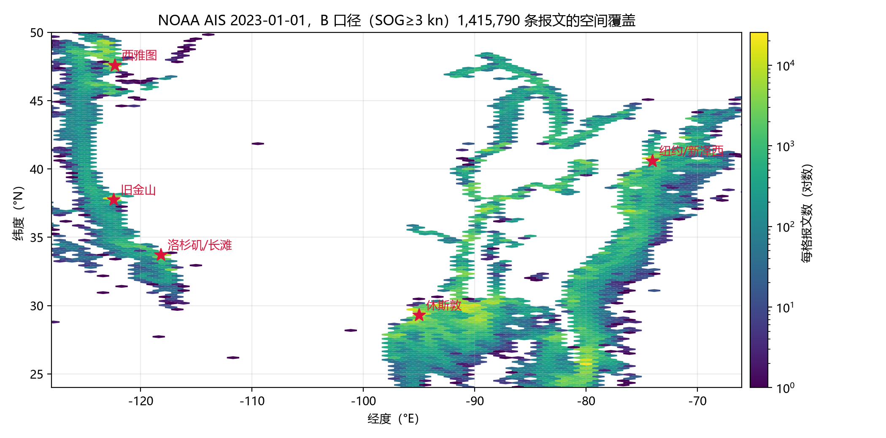
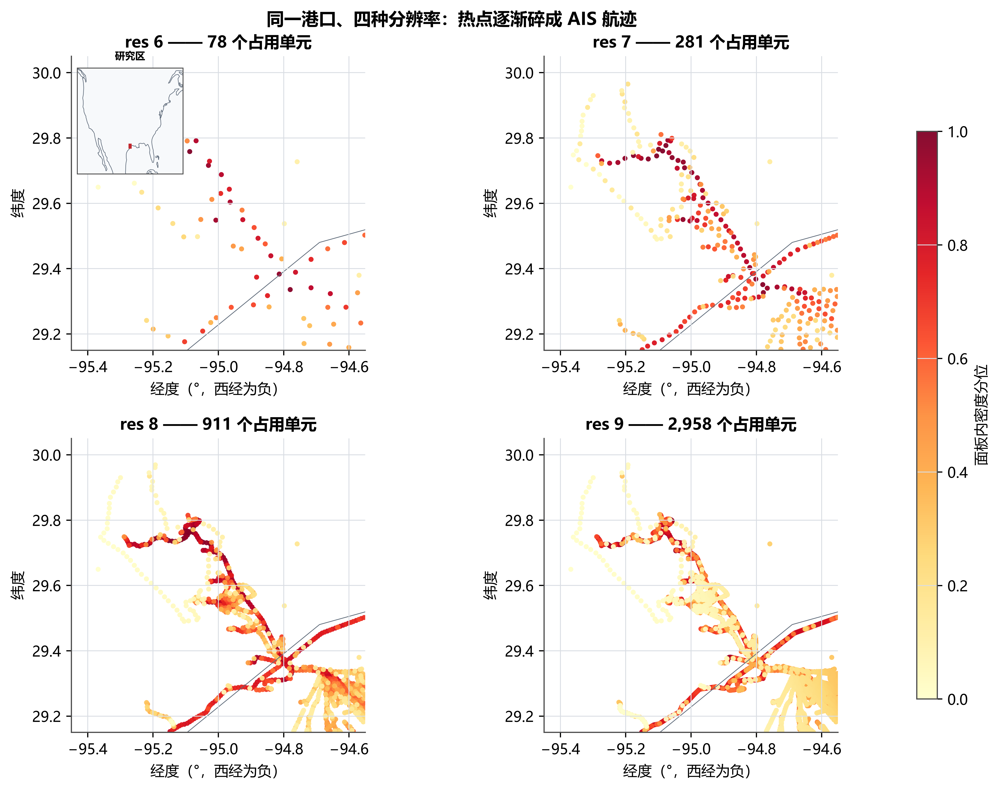
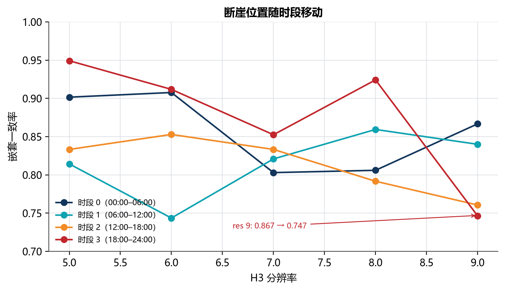
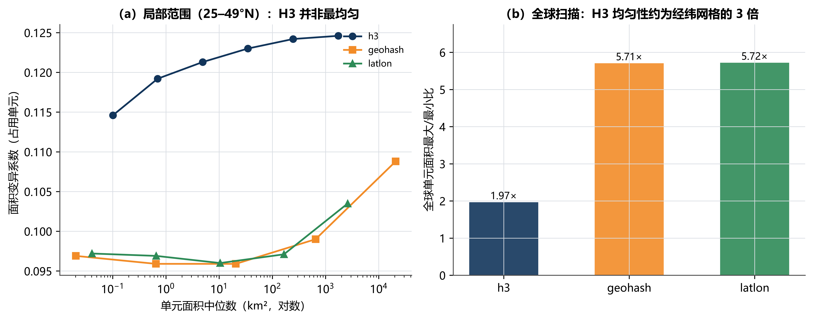
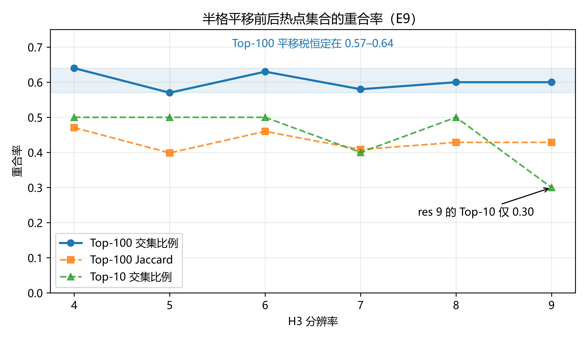
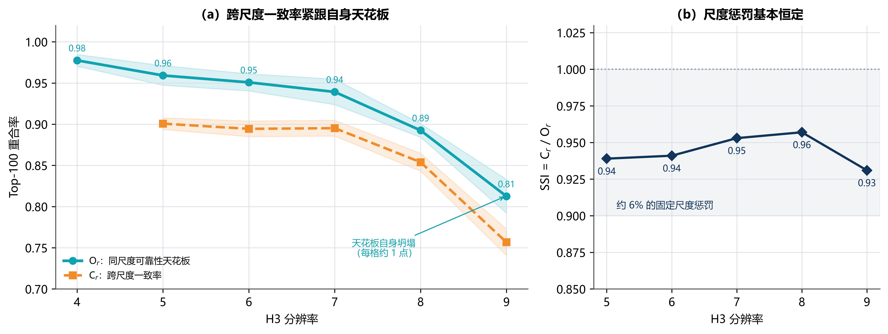
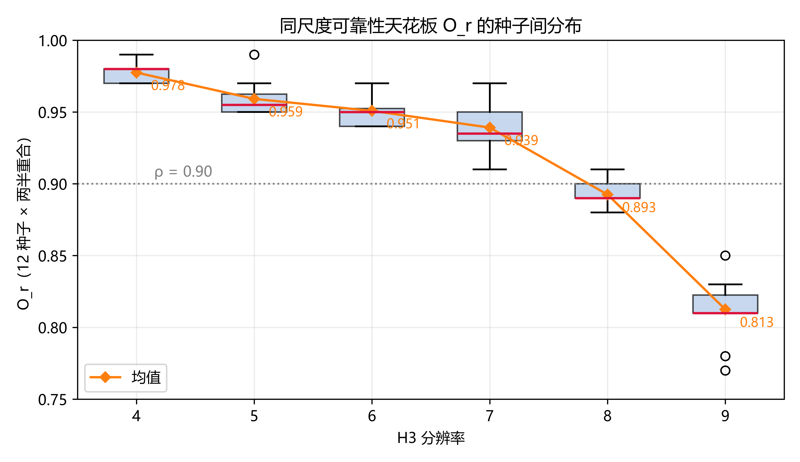
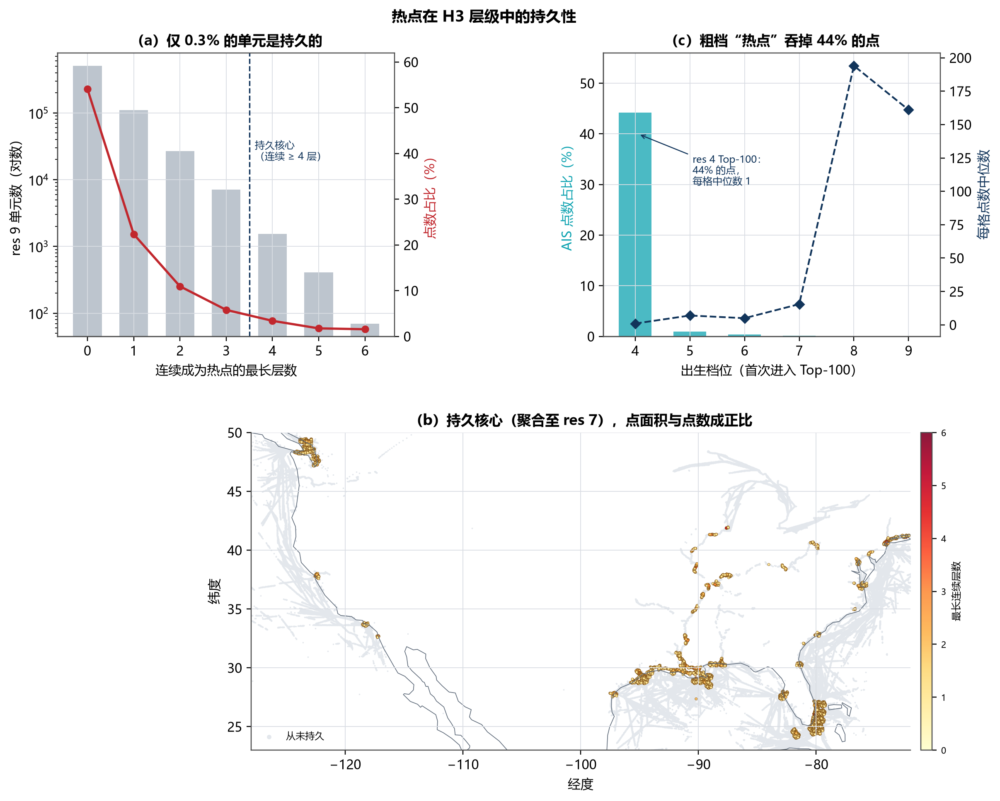
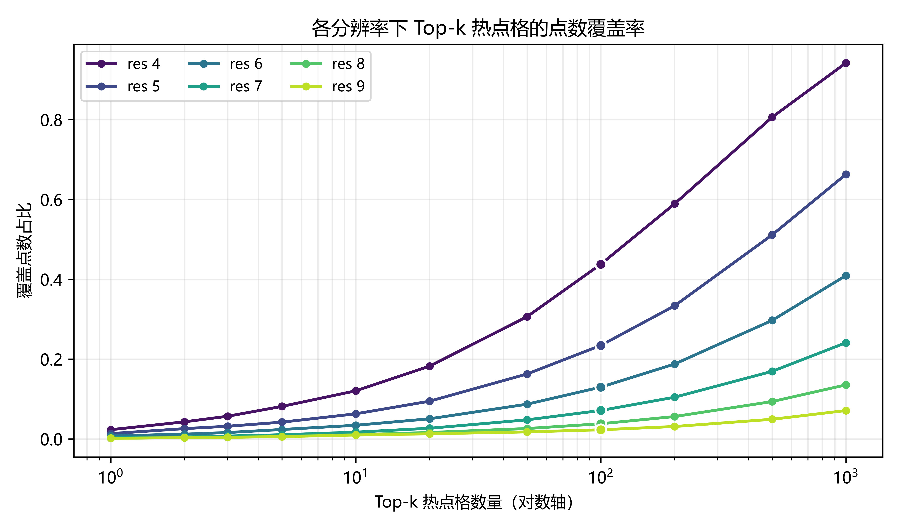

# 分辨率如何改变“船舶热区”的结论

## ——一次把“按经验选档”改写成“按可复现性选档”的实验

> 课程：海洋数据挖掘　专业：海洋技术　日期：2026-11
>
> **代码与全部 AI 对话记录（Public 仓库）：<https://github.com/a8617667122022/zju-marine-datamining-final>**
>
> 仓库内含：`code/`（可复现脚本）、`results/`（实验产物与图）、
> `ai-log/`（21 轮对话原文）、[data/README.md](../data/README.md)（数据来源与复现方式）。

---

## 摘要

同一份 AIS 数据用不同大小的 H3 网格统计，会得到不同的热点图；格子过细时，一条报文的进出就可能改变热点名单。本文使用 2023 年 1 月 1 日美国近海 AIS 数据，在 res 4—9 上比较 Top-100 热点。航行船子集含 1,415,790 条报文；res 9 的 653,022 个占用网格中，每格报文数中位数仅为 1。热点层级一致率从 res 5 的 0.899 降至 res 8 的 0.862，并在 res 9 降至 0.747。为判断下降来自换格还是样本不足，本文定义同尺度可靠性天花板 `O_r`：固定分辨率，按四个 6 小时时段分层，将报文随机分成两半，各取 Top-100 热点，以 12 个随机种子计算平均重合率。`O_r` 从 res 4 的 0.978 降至 res 9 的 0.813，而 SSI（跨尺度一致率/`O_r`）保持在 0.93—0.96；res 8→9 的一致率下降约八成可由同尺度可复现性下降解释。选档规则因此设为“在满足 `O_r ≥ ρ` 的档位中选最细一档”。ρ = 0.90 时推荐 res 7，热点层级持久性和局部方差比两项独立检验结果一致。该规则已实现为 h3_advisor 工具，可按数据和可靠性下限输出推荐分辨率。

**关键词：** H3；可变面元问题；可靠性天花板；热点分析；AIS；特征尺度

## Abstract

Fine H3 grids can make AIS hotspots sensitive to single reports. Using 1,415,790 US coastal AIS reports from 1 January 2023, we compare top-100 hotspots at H3 res 4–9. Agreement falls from 0.899 at res 5 to 0.862 at res 8 and 0.747 at res 9. To separate grid effects from sampling variability, O_r splits reports within four six-hour strata at fixed resolution and averages top-100 overlap between halves over 12 seeds. O_r falls from 0.978 to 0.813, while SSI = C_r/O_r stays at 0.93–0.96; about 80 percent of the res 8–9 loss reflects lower within-scale reproducibility. Choosing the finest resolution with O_r >= rho gives res 7 at rho = 0.90, confirmed by hotspot persistence and the local variance ratio. The rule is implemented in h3_advisor.

**Keywords:** H3; modifiable areal unit problem; reliability ceiling; hotspot analysis; AIS; feature scale

---

## 1 我要做的事：同一片海，换一把尺子，热点就搬家

**这一章回答一个问题：这件事为什么非做不可。先看一个具体场景，再看数据，最后把场景收成三个可以动手回答的问句。**

### 1.1 一个具体到能复述的麻烦

在休斯敦—加尔维斯顿海域，我用 H3 的 res 7（每格约 5.2 km²）取密度最高的 100 个格子，画出来的是一条从港口伸向湾口的连续热区：航道两侧亮、外海暗，与港口调度员的直觉一致。

把同一份数据换成 res 9（每格约 0.105 km²，比一个标准篮球场大十几倍），同一片海域的热点碎成几百个孤立亮点：有的落在航道上，有的落在锚地边缘，还有的落在别处莫名其妙的位置。

这不是图画得不好。这一天全美近海的航行船报文共 1,415,790 条，摊到 653,022 个 res 9 格子上，**每格中位数只有 1 个点**。也就是说，res 9 图上所谓的“密度”，很多时候就是“有没有一条船刚好落进这个格子”。

于是问题变得很具体：**res 9 上新冒出来的那些亮点，是新结构，还是采样噪声？** 如果换一天的数据、或者只用半天数据，这些亮点还会在原来的位置吗？

这个问题不是 H3 的缺陷。H3 只是把地球切成格子，切多细由人决定。真正缺的是一条规则：**什么情况下细到某一档就不能再细了。**

我为什么盯上这个问题？老师第 3 讲课时 2 的课件给了三个数（res 5 约 253 km²、res 7 约 5.2 km²、res 9 约 0.1 km²）和一句建议：「按业务尺度、数据质量和样本量选档；精细程度必须有数据支持」。三个数我都抄下来了，但"样本量够不够"这件事，课件没告诉我怎么算。同一页还有一句「没有统一红线：看定位误差、采样与样本量」。我对着这句话想了一会儿：AIS 的定位误差只有几米，比 res 7 的格子（约 1.4 km）小几百倍，定位精度肯定不是瓶颈；那真正会出问题的就是格子越细、每格里船越少——也就是"采样与样本量"。课时 1 开头说"经纬度是地址不是尺子"，放到这件事上就是：报文里那串经纬度只是地址，格子才是量东西的尺子。**尺子换到哪一档、量出来的东西还靠不靠谱——这就是本文要补的洞。**

### 1.2 我用的是什么数据

| 项目 | 取值 |
|---|---|
| 数据源 | NOAA MarineCadastre AIS，美国近海 |
| 日期 | 2023-01-01（UTC，24 小时） |
| 口径 A（全量） | 8,156,509 条报文 |
| 口径 B（航行船） | 1,415,790 条报文（SOG ≥ 3 kn） |
| 空间范围 | 25°N–49°N 的美国东、西海岸与墨西哥湾 |
| 分辨率 | H3 res 4–9（约 1770 km² 至 0.105 km²） |
| 热点定义 | 每档密度（**报文点数** ÷ 单元实际面积）最高的 100 个格子 |

为什么分成 A、B 两个口径：锚泊和靠泊的船会在码头上堆出极高的密度，那段密度反映的是“停在哪”，不是“船往哪开”。行文以 B（航行船）为主口径，A 用来对照“静止船会把问题放大多少”。

**口径声明（按老师课时 2 的要求写在这里）：** 全文的“点数”一律指 AIS **报文条数**，不是去重后的船舶数；热点密度也用报文点数计算。报文数受船载设备上报频率影响（高速航行时几秒一条、锚泊时几分钟一条），所以它放大了静止船的权重——这正是 A、B 两个口径要对照的事，也是第 6 章局限第 1 条的来源。若改用去重船数口径，所有数字需要重算。另外，B 口径的 SOG ≥ 3 kn 属于课件说的「AIS 可见定语」——只用报文自带字段划分子集，不引入任何外部数据。

还有一个容易踩的坑：这条密度数的是报文，不是船。一艘船在码头上停一晚能发几百条报文，另一艘刚路过只发了三条就走了——按报文数，前者是后者的上百倍，但它们都只是"一艘船"。所以我不能拿这张热点图去数"这个港口今天来了多少艘船"：要数船，得先按 MMSI 去重，或者把同一艘船短时间内的连续报文算作一次到访——那是另一套口径、另一张图（课件把这两类叫"到访密度"和"在场密度"）。本文只回答"哪里报文密度高"，不冒充"哪里船多"。

先看这批数据长什么样。图1.1 是 B 口径 141.6 万条报文的空间覆盖：三大海岸带清晰可见，休斯敦、纽约、洛杉矶/长滩几个大港在图上一眼可辨；内河与远海之间的空隙就是“没有船的地方”——后面所有关于“细格没有样本”的讨论，都发生在这张图的明暗交界处。



**图1.1**　研究区与数据覆盖：B 口径报文的空间分布（六边形聚合，对数色标），星标为五大港口。　（口径：2023-01-01 UTC；SOG ≥ 3 kn）

### 1.3 三个问句与三件交付物

我把“怎么选分辨率”拆成三个可以动手回答的问句：

1. 换一档分辨率，昨天画的“热点图”会不会变？
2. 如果会变，变的那部分是“尺度效应”，还是“样本不够”？
3. 有没有一条能写进代码、交给同事直接复用、**并且不需要拍一个魔法阈值**的选档规则？

对应的交付物是三件：一条判据（第 3、4 章）、一个可调用的工具（第 5 章）、一份不加修饰的 21 轮 AI 对话记录（第 7 章与仓库 `ai-log/`）。

**本文的一句话答案：** 本数据上应当选 **res 7**；判据不是“一致率是否高于 0.85”，而是“**这一档换一半样本，热点还能不能复现九成**”。

后面七章按这个顺序展开：第 2 章看别人做到哪一步、还缺什么；第 3 章讲我的问法和别人哪里不一样；第 4 章把六条具体观点逐条摆出证据；第 5 章把判据做成工具；第 6 章说清这些结论的边界；第 7 章交代 AI 帮了什么、我怎么反驳它；第 8 章收结论。

---

## 2 这个方向现在到哪一步了

**这一章回答三个问题：网格技术怎么演进到今天的；热点分析一般怎么定尺度；这个方向上还有哪几场没打完的争论。**

### 2.1 网格：从“方格子”走到“六边形”

最早的空间索引就是经纬度矩形网格。它的问题很直观：经度 1° 对应的地面距离随纬度收缩。在 60°N，经度 1° 只有赤道处的约一半长，同样“一格”，高纬的实际面积不到低纬的一半。

Geohash 把经纬度编码成一串字符，前缀相同即位置相近，很适合做数据库索引；但它的格子仍然是矩形，面积随纬度畸变的毛病一点没改。

六边形网格换了个思路：每个格子到中心的距离一致，邻居固定 6 个，没有“角”这种容易被误判的形态。Uber 的 H3 在 2018 年开源：16 级层次结构，父子关系稳定。课件给的三条细节值得记下：孔径 7，也就是相邻两级面积差约 7 倍；全球固定有 12 个五边形（五边形没法像六边形那样再切出六个小六边形，所以是固定的）；每个格子一个 64 位整数 ID。格子数每细一级涨约 7 倍——res 4 全球 28.8 万格，res 9 就是 48.4 亿格（见表2.1）。如今航运、外卖、网约车都拿它当空间索引；S2 用球面四叉树，A5 用五边形，各有取舍。到 2025 年，OGC 发布离散全球网格系统（DGGS）的 API 标准，说明“用一套全球统一网格做空间索引”已经从公司内部工具变成了公共基础设施。

但六边形也有代价。H3 官方 restable 给出：同一分辨率内，单元面积的最大值与最小值之比在 res 4–9 约为 1.970–1.993 倍；五边形单元的面积约为六边形的 0.505 倍。所以“H3 等积”是一个**全球尺度**的命题，不能理解成“每一格面积相同”。

把本文用到的六档参数列全，也当作对课件三组数字的核验——计算值 res 5 = 252.9 km²、res 7 = 5.16 km²、res 9 = 0.105 km²，与课件给的 253 / 5.2 / 0.1 一致；相邻两级全球单元数恰好 ×7，正是课件的量级口诀：

| res | 平均单元面积（km²） | 平均边长（km） | 全球单元数 | 本数据占用单元数（B 口径） |
|---|---|---|---|---|
| 4 | 1770.3 | 26.07 | 288,122 | 2,416 |
| 5 | 252.9 | 9.85 | 2,016,842 | 9,329 |
| 6 | 36.13 | 3.73 | 14,117,882 | 32,926 |
| 7 | 5.16 | 1.41 | 98,825,162 | 105,868 |
| 8 | 0.737 | 0.53 | 691,776,122 | 305,700 |
| 9 | 0.105 | 0.20 | 4,842,432,842 | 653,022 |

### 2.2 热点：三条路线，同一个旋钮

找“船聚在哪”，工程上常见三条路线：

- **核密度估计（KDE）**：把每个点摊成一个平滑的核，叠加成密度面。核带宽就是尺度。
- **局部空间统计（Getis-Ord Gi\* 统计）**：对每个格算邻域内的聚集是否显著。邻域距离就是尺度。
- **密度聚类（DBSCAN 一类）**：把“够密”的点连成簇。邻域半径 eps 就是尺度。

三条路线都有同一个旋钮：**尺度参数**。而这个旋钮几乎都靠经验、试错或者“看起来顺眼”来拧。Esri 的增量空间自相关是少数把“选尺度”做成工具的尝试——它在多个距离上算 Moran's I，取 z 分数峰值作为推荐距离。但峰值只说“这个距离上聚集最显著”，不说“这个距离上的结论能不能复现”。

### 2.3 三场还没打完的争论

| 争论 | 一种立场 | 另一种立场 | 目前的状况 |
|---|---|---|---|
| 可变面元问题（MAUP）有多严重 | 换网格只是表示方式不同，结论大体稳定 | 划分方式能改变相关系数、显著性甚至符号（Openshaw & Taylor, 1979） | 共识是“会变”，但没有量化到能指导选档 |
| 有没有“通用”最优尺度 | 数据自带特征尺度，可以用变差函数、局部方差找出来 | 特征尺度依赖邻域定义与加权方式，换方法就换答案 | 有工具，无标准 |
| AIS 数据撑不撑得起细网格 | 船多、报文密，细格也有样本 | 报文间隔分钟级、静止船堆积，细格中位样本常为 1 | 缺少“多细算太细”的判据 |

第三场争论最容易被忽略。船舶 AIS 的报文间隔随航速变化：高速时几秒一条，锚泊时几分钟一条；同一艘船连续发的报文在空间上高度相关，并不是独立样本。这意味着“总共有 140 万条”不等于“有 140 万个独立观测”。分辨率越细，这个差距越致命。

### 2.4 共同的缺口：都在问“结构在哪”，没人问“结构稳不稳”

| 方法 | 能回答 | 不能回答 |
|---|---|---|
| KDE 与带宽选择 | 平滑后的密度长什么样 | 换一半样本，这张图还一样吗 |
| Gi\*、增量空间自相关 | 哪个尺度上聚集最显著 | 显著不等于可复现 |
| 变差函数、局部方差 | 数据的特征尺度大概在哪 | 有限样本下的稳定性 |
| 零模型、随机化检验 | 热点是否偏离随机 | 0.86 与 0.75 谁更可信 |
| **本文** | **这一档自己能不能复现自己** | 不回答业务尺度，也不回答统计显著性 |

这张表的最后一行就是我的切入点。下面第 3 章说明它和上面四行到底差在哪。

---

## 3 我的创新点：不问“差多少”，先问“自己最好能有多好”

**这一章回答两个问题：我的问法和别人有什么不一样；这个问法能落成哪几个可检验的量。**

### 3.1 一句话，和一个称重的类比

常见问法是：**“换一档分辨率，热点变了多少？”** 然后拿这个变化量去比一个经验阈值。

我的问法换了一层：**“这一档分辨率，就算不换档，只换一半样本，它自己还能复现多少？”**

打个比方。你要用一台秤比较两袋米谁重。如果这台秤本身每次称同一袋米都会差 20%，那你没法用它判断两袋米差 5% 还是 10%——先得知道这台秤的重复性误差是多少。分辨率就是这台秤，O_r 就是它的重复性误差。

这个换法带来三个直接后果：

1. 比较跨尺度损失之前，先扣掉“这一档自己的采样极限”，剩下的才是尺度效应；
2. 判据里的阈值不再是“一致率多少算好”这种拍脑袋的数，而是“我要求换一半样本后至少复现多少”，这个数是分析者自己声明、可以讨论的；
3. 每条结论都必须带上口径（K 取多少、热点怎么定义），不能再假装是普适常数。

### 3.2 与既有做法的五点差别

| 维度 | 常见做法 | 本文 |
|---|---|---|
| 提的问题 | 跨尺度一致率是多少 | 同尺度可复现性的上限是多少 |
| 判据 | 一致率不低于某个经验阈值（如 0.85） | 取最细的 r，使 O_r 不低于声明的下限 ρ |
| 断崖归因 | 默认是尺度效应 | 先测采样极限，再判断剩余部分 |
| 验证方式 | 一个指标说了算 | 三条互不依赖的判据交叉验证 |
| 输出 | 一个推荐数字 | 一份写明口径的“合同” |

### 3.3 三个原创点，各用一句大白话说清

**原创点 A：可靠性天花板 O_r 与归一化指数 SSI。**
把同一天的数据按 6 小时切成四段（0–6 点、6–12 点、12–18 点、18–24 点）——这就是课件“时空立方体”里时间窗的用法：两半样本必须在同样的昼夜构成下比，不然比出来的是白天和半夜的差别，不是分辨率的问题——在每个时段内随机分成两半；两半各自取密度 Top-100，数一数重合了多少个格子；换 12 个随机种子取平均。得到的数就是这一档的 O_r。它的含义只有一句：**不换分辨率，只换一半样本，这一档的热点还能重合多少。**

有了 O_r，跨尺度的损失就可以归一化：

$$\mathrm{SSI}_r=\frac{C_r}{O_r}$$

`C_r` 是这一档与上一档的一致性，`O_r` 是这一档自己的天花板。SSI 接近 1，说明换档的损失和换半样本的损失差不多，损失主要来自采样；SSI 明显小于 1，才说明尺度本身在丢信息。这里有一个必须遵守的前提：**分子和分母必须用同样的样本量计算**，否则比值里会混进样本量差异。这一条我最初没有意识到，是后来检查实现时才发现的（见 4.3 与 7.3）。

**原创点 B：层级持久热点（lifetime）。**
把 H3 的父子树当成一棵树：对 res 4…9 各取 Top-100，看一个 res 9 的叶子在它的 6 层祖先里，有几层是热点。连续命中的层数叫 `longest_run`，达到 4 层就记为“持久”。它回答的问题是：**细档的热点是“搬到别处去了”，还是“还在原地、只是名次变了”。**

**原创点 C：局部方差比（LV）与特征尺度。**
对每个格，算它和 1 环邻居的密度差，再和全体方差比：

$$LV_r=\frac{\sum_i w_i\,(x_i-m_i)^2}{\sum_i w_i\,(x_i-\bar x)^2}$$

`x_i` 是格 i 的密度，`m_i` 是它 1 环邻域的加权平均密度，`w_i` 取点数。LV 大，说明局部比全局还乱，接近噪声；LV 小，说明相邻格相似，有结构。**谷底**所在的那一档，就是数据的特征尺度。这条路线完全不碰 Top-K，因此可以独立检验 A。

### 3.4 判据：把“拍阈值”换成“声明下限”

由 A 直接得到选档规则：

> **取最细的分辨率 r，使得同尺度可靠性 O_r 不低于分析者声明的下限 ρ。**

ρ 不是数据给的，是人声明的。本文取 0.90，含义是“换一半样本，热点仍能复现九成”。**把 ρ 写在报告里，比偷偷用一个 0.85 要诚实得多**：读者知道你在什么可靠性要求下做的选择，也知道把 ρ 改成 0.95 会得到更保守的答案。

### 3.5 我把它们做成了九个实验

| 编号 | 做什么 | 回答什么 | 结果在哪 |
|---|---|---|---|
| E1 | 单元面积随纬度变化 | 断崖是不是面积/纬度造成的 | 4.2 |
| E2 | 首版“相邻档 Top-100 的 IoU” | 第一版指标能不能用 | 3.6、7.2（失败） |
| E3 | 每格样本量随分辨率变化 | 细档还有没有样本 | 4.2 |
| E4 | 四个 6 小时时段分别重算 | 断崖是不是某个时段的现象 | 4.2 |
| E5 | H3 / Geohash / 等经纬对照 | 换网格能不能救回来 | 4.2 |
| E6 | 分时段 split-half 可靠性 O_r | 每档自己最好能做到多好 | 4.2 |
| E7 | 层级持久热点与等质量口径 | 细档热点是搬家还是换名次 | 4.4 |
| E8 | 局部方差比 LV | 数据的特征尺度落在哪一档 | 4.5 |
| E9 | 半格平移后重算热点 | 热点对格子对齐方式有多敏感 | 4.2 |

八个实验之前还有两道地基校验，对应老师“发布前检查”的前两项：**已知点验算**（拿几个已知经纬度检查落格结果，确认 lon/lat 顺序没有颠倒）和**总量守恒**（落格前后的报文总数逐档相等）。这两项不出错不会出现在任何结论里，出了错会让后面所有数字作废——所以先写在这里。课件点过三个新手最容易栽的坑，我在落格阶段逐一防了：一是球面畸变，纬度越高经度一格越窄，所以密度一律除以每格的真实面积，E9 平移经度时也按 `cos(lat)` 折算；二是反经线回卷，经度跨过 ±180° 会突然跳变，我的数据全在西半球，经度统一取 [-180, 180] 并写进口径合同；三是口径漂移，脚本改着改着口径就变了，所以全文的口径只在 1.2 定义一次，后面所有脚本只引用、不重写。

另外，教材实验步骤 ⑦ 要求「至少两组扰动对照：换分辨率重做 + 等价的半格偏移/换系」。本文 E1–E8 全程换分辨率重做，E5 用 Geohash/等经纬对照满足「换系」一组，E9 补做「半格偏移」一组——**两组扰动对照现在都齐了**（E9 的结果与读数见 4.2）。

### 3.6 过程中我否掉了自己三次

这三件事在第 4、7 章还会出现，这里先给结论：

1. **第一版指标是错的。** 相邻档 Top-100 的 IoU 在四个相邻对上分别是 0.10、0.12、0.13、0.11——五个档位几乎同一个数。一个在所有档位都一样的指标，一定没在测分辨率。
2. **“一致率 ≥ 0.85”是拍的。** 我追问这个数从哪来，查文献没有通用标准，用零模型校准又发现它只能证明“热点不随机”，无法区分 0.86 和 0.75。
3. **LV 的方向我读反了。** 第一版取峰值当特征尺度，推荐 res 4；回去读 Woodcock 与 Strahler 1987 年原文的图，才发现谷底才是特征尺度。

这三次都不是“调参调出来的”，而是“承认自己错了、回去改定义”。第 7 章会逐条给出出处，并写清每一处是谁先发现、我做了什么裁决。


---

## 4 基于这个创新点，我提出的六条不同观点

**这一章是全文的证据主体。每条观点都按同一个格式写：先写常见说法，再写我的说法，然后摆证据，最后交代这条观点在什么范围内成立。**

### 4.1 观点一：稳定曲线不是“先变化后收敛”，而是“缓慢下滑 + 断崖”

**常见说法。** 分辨率越细，热点图越接近真实；两档之间的差异会随分辨率变细而缩小，曲线上会出现一个“平台”，平台起点就是合适档位。

**我的说法。** 本数据上没有平台。一致率是一路缓降，到 res 8→9 突然掉下去；而且全量口径比航行船口径更早掉。

| res | 层级一致率（B 航行船） | 层级一致率（A 全量） | 等质量 IoU（B） |
|---|---|---|---|
| 5 | **0.899** | 0.955 | 0.336 |
| 6 | 0.894 | 0.922 | 0.333 |
| 7 | 0.877 | 0.863 | 0.352 |
| 8 | 0.862 | **0.747** | 0.359 |
| 9 | **0.747** | 0.727 | 0.364 |


**图4.1**　(a) 层级一致率随分辨率的变化；(b) 等质量 IoU 随分辨率的变化。　（口径：H3 res 4–9；2023-01-01 UTC；报文密度 Top-100）


三个细节值得注意：

1. B 口径从 res 5 到 res 8 一共只掉了 3.7 个百分点，但 res 8 到 res 9 一次掉了 11.5 个点。这种“前面平、后面陡”的形状，不是平台，是断崖。
2. 等质量 IoU 全程锁在 0.33–0.36，甚至略有上升。它根本没有在“收敛”，也没有给出任何可用的拐点。
3. A 口径在 res 8 就跌到 0.747，比 B 早一档。**静止船把问题提前了一档，这本身就是“样本被稀释”的迹象。**

老师课件把这类敏感性曲线分成三型：平台型说明结论对口径稳健；单调漂移型提示 MAUP 主导，应改用区间表述；**断崖型多为工程伪影，应先排障后发布**。所以我把断崖当成嫌疑犯而不是结论——4.2 节的四个排除实验（面积、样本量、时段、换网格）就是照“先排障”的顺序做的排障程序；排完四个平庸解释还剩一个，才轮到“样本极限”出场定案。

图4.2 是上表的直观版本：res 6–7 的热点仍连成港口—航道走廊；res 8 起开始碎裂；到 res 9 已大多是沿航迹分布的孤立小点。**同一片海域的“热点”开始随格子边界的微小移动而互换位置。**



**图4.2**　同一港口范围（休斯敦/加尔维斯顿）在 res 6–9 下的热点结构；左上角为全国定位。　（口径：H3 res 4–9；2023-01-01 UTC；报文密度 Top-100）


**这条观点的边界。** 它依赖“密度 Top-100”这个热点定义。换成等质量口径，曲线的形状会变（4.4 会展示），但“没有平台”这一点不变。

### 4.2 观点二：断崖来自样本不够，不来自几何

**常见说法。** 细格的问题是格子太小、边界效应严重、面积不均匀；只要换一种更均匀的网格，或者做面积校正，细格就能用。

**我的说法。** 断崖的主因是采样不足。几何问题存在，但它解释不了 res 9 的坍塌。

要证明这一点，必须先排除四个更平庸的解释。下面四个实验就是干这件事的。

**E1：会不会只是面积随纬度变了？**


**图4.3**　(a) H3 各分辨率的平均单元面积随纬度带的变化；(b) 同一纬度带内的面积变异系数。　（口径：H3 res 4–9；2023-01-01 UTC；报文密度 Top-100）


- H3 的平均面积随纬度几乎是平的：res 5 在 15°N 是 206 km²，在 45°N 是 245 km²。**但这不等于“等积”**：官方 restable 显示，同档内面积最大值与最小值之比在 1.970–1.993 之间，五边形约为六边形的 0.505 倍。
- 准确的说法是：**H3 没有纬度方向的系统偏差，但存在二十面体几何导致的位置偏差。**
- 真正“面积随纬度畸变”的是经纬矩形网格（含 Geohash），按 `cos(lat)` 收缩。
- 本数据只覆盖 25°N–49°N 的窄带，面积口径的影响很小：res 7 下按点数取 Top-100 与按密度取 Top-100 的 IoU 是 **0.942**，实际占用单元的面积变异系数是 **0.121**。
- 这里我差点把一个官方数字写成自己的发现。初稿写“面积极差 1.97 倍是我发现的”，查 restable 才知道 1.970–1.993 是官方给的数，我做的是复现。这次是 AI 纠正了我（7.3 详述）。

**E3：每格到底还剩几个点？**


**图4.4**　每格点数随分辨率的变化，以及点数 ≥ 30 的单元占比。　（口径：H3 res 4–9；2023-01-01 UTC；报文密度 Top-100）


| res | 每格中位数 | 每格均值 | 点数 ≥ 30 的占比 |
|---|---|---|---|
| 4 | 132 | 586.0 | 73.4% |
| 5 | 40 | 151.8 | 59.0% |
| 6 | 14 | 43.0 | 25.6% |
| 7 | 5 | 13.4 | 7.5% |
| 8 | 2 | 4.6 | 2.3% |
| 9 | **1** | 2.2 | **0.6%** |

res 9 每格中位数 1 个点。这意味着“密度”实际上退化成“有没有点”。**断崖最可能的解释不是几何，是样本。**

**E4：断崖会不会只是某个时段的现象？**



**图4.5**　四个 6 小时时段的层级一致率曲线。　（口径：H3 res 4–9；2023-01-01 UTC；报文密度 Top-100）


| 时段 | res 7 | res 8 | res 9 |
|---|---|---|---|
| 00–06 | 0.803 | 0.806 | 0.867 |
| 06–12 | 0.821 | 0.859 | 0.840 |
| 12–18 | 0.833 | 0.792 | 0.761 |
| 18–24 | 0.853 | 0.924 | 0.747 |

**断崖的位置并不固定。** res 9 在凌晨还能到 0.867，到夜间跌到 0.747。如果断崖由固定的几何常数决定，它应该每个时段都出现在同一档；它随时间和流量移动，说明它由**样本量**决定。

**E5：换一套网格能不能救回来？**



**图4.6**　(a) 实际占用单元的面积变异系数（25–49°N）；(b) 全球纬度扫描下的面积极差。　（口径：H3 res 4–9；2023-01-01 UTC；报文密度 Top-100）


| 系统 | 档位 | 局部面积变异系数 | 全球面积极差 | 最接近 10 km² 档的一致率 |
|---|---|---|---|---|
| H3 | res 4–9 | 0.115–0.125 | **1.97×** | 0.877（res 7） |
| Geohash | p3–p7 | 0.096–0.109 | 5.71× | 0.789（p5） |
| 等经纬 | 0.5°–0.002° | 0.096–0.104 | 5.72× | 0.738（0.031°） |

结果和直觉相反：

- **局部看，H3 的面积变异系数反而最大**（0.125 对 0.096）。因为数据只在 25–49°N 的窄带里，经纬网格的 `cos(lat)` 在这一带几乎不变，H3 单元形状的不规则反而贡献了更多离散度。
- **全球看，H3 完胜**（1.97 倍对 5.71 倍）。等积性是一个全球命题。
- **三种网格的一致率量级相同（0.74–0.88），没有哪一种能救回 res 9 的断崖。**

结论一句话：**换网格改变的是几何均匀性，改变不了统计充分性。** 这句话直接把我从“是不是该换 S2 或 Geohash”的岔路上拉了回来。

**E9：半格平移——教材步骤 ⑦ 要求的另一组扰动。**

老师课堂活动用 30 个点演示过“半格平移、热点搬家”。E9 把它做完整：把全部 141.6 万条报文的经纬度整体平移半格边长（纬度方向固定、经度方向按 `cos(lat)` 折算），等价于网格相对船位挪了半格、格子结构本身不动；再重算各档密度 Top-K，量化平移前后热点集合的交集比例（`|A∩B|/K`）：

| res | 格边长（km） | Top-100 交集比例 | Top-100 Jaccard | Top-10 交集比例 |
|---|---|---|---|---|
| 4 | 26.07 | 0.64 | 0.471 | 0.50 |
| 5 | 9.85 | 0.57 | 0.399 | 0.50 |
| 6 | 3.72 | 0.63 | 0.460 | 0.50 |
| 7 | 1.41 | 0.58 | 0.409 | 0.40 |
| 8 | 0.53 | 0.60 | 0.429 | 0.50 |
| 9 | 0.20 | 0.60 | 0.429 | **0.30** |



**图4.7**　半格平移前后热点集合的重合率：Top-100 交集比例、Top-100 Jaccard 与 Top-10 交集比例。　（口径：H3 res 4–9；2023-01-01 UTC；报文密度 Top-100/Top-10）

两个读数（三条曲线画在图4.7 里）：

1. **平移税对所有档位几乎恒定**：Top-100 交集比例锁在 0.57–0.64，看不出随分辨率的系统趋势。这正是 MAUP **划区效应**的样子——它是一笔“格子对齐”的固定税，res 4 就收走了约四成。**它解释不了断崖**：断崖只在 res 9 出现，而平移税全程不变，说明断崖不是网格对齐的伪影。这与 4.3 的 O_r 互补——O_r 测的是随分辨率恶化的采样极限，E9 测的是不随分辨率变化的划分效应。
2. **Top-10 比 Top-100 敏感得多**（res 9 只剩 0.30）。老师课堂演示用的正是“top-10 热点重合率”——集合越小，名次越容易被格子边界的微小移动翻转。发布结论时应引用 Top-100 这类较大的集合，或在口径合同里写明 K；这与课件“判据预先声明”的要求一致。

至此教材步骤 ⑦ 的两组扰动对照齐了：换系（E5）+ 半格偏移（E9）。

**E6：直接测一下“这一档自己能做到多好”。**

上面四个实验只是排队嫌疑，真正定案的证据是 O_r。



**图4.8**　(a) 同尺度可靠性天花板 O_r 与半样本内的跨尺度一致率 C_r；(b) 归一化尺度稳定指数 SSI。　（口径：H3 res 4–9；2023-01-01 UTC；报文密度 Top-100）


| res | 天花板 O_r（±std） | Jaccard | 半样本内 C_r（±std） | SSI |
|---|---|---|---|---|
| 4 | 0.9775 ± 0.0072 | 0.9561 | — | — |
| 5 | 0.9592 ± 0.0119 | 0.9218 | 0.9007 ± 0.0071 | 0.939 |
| 6 | 0.9508 ± 0.0104 | 0.9065 | 0.8944 ± 0.0095 | 0.941 |
| 7 | 0.9392 ± 0.0155 | 0.8857 | 0.8952 ± 0.0096 | 0.953 |
| 8 | 0.8925 ± 0.0083 | 0.8060 | 0.8539 ± 0.0109 | 0.957 |
| 9 | **0.8125 ± 0.0205** | **0.6847** | **0.7567 ± 0.0161** | **0.931** |

注意表注：这里的 `C_r` 是在**半样本内部**算的，和表4.1 的全样本跨尺度一致率不是同一个量。之所以要这么算，是因为分母 `O_r` 也是半样本算的——**分子分母同样本量，比值才有意义**。这个细节是我在检查 AI 的实现代码时发现的（7.2）。

三个可以直接写进结论的观察：

1. **天花板自己在坍塌。** O_r 从 0.978 一路降到 0.813。res 9 的含义是：即使分辨率不变，只换一半样本，Top-100 里也有近 **19%** 的格子对不上；换成 Jaccard，只剩 0.685。
2. **C_r 几乎完全跟随 O_r。** 两条曲线在所有档位上平行，SSI 稳定在 **0.93–0.96**。跨尺度本身只带来约 **6%** 的固定损耗，而且不随分辨率放大。
3. **断崖的归因。** res 8→9 的一致率相对下降 11.4%，其中 O_r 下降贡献约 8.9 个百分点，SSI 下降贡献约 2.7 个百分点——**约八成来自可靠性天花板，而不是尺度效应。**

O_r 的原始分布也值得看一眼：图4.9 是 12 个种子 × 两个半样本的 24 个 O_r 值的箱线图。res 4–7 的箱体很紧（std 0.008–0.016），res 9 最宽（std 0.021）——**细档的可靠性不仅更低，而且更不稳定**，同一份数据换个随机种子，res 9 的 O_r 能差 ±0.02。这也是判据必须留出余量（ρ=0.90 而不是贴着均值）的原因。教材 p.52 有句很直白的话："res 9 再细，就是伪精度。"我的数据把这句话演了一遍：res 9 一格里平均只有 1 个点，同一艘船挪一格，这格的"热点"就凭空出现、那格就凭空消失——数字算得出来，结论靠不住。但课件备注也提醒这句话不能当普遍结论用，得看数据质量。O_r 就是那个"看"的工具：在我这天的数据上，res 9 换一半样本只能复现 81.3% 的热点，这就是"伪精度"三个字的具体数值。



**图4.9**　同尺度可靠性天花板 O_r 的种子间分布：12 个随机种子 × 两个半样本，共 24 个 O_r 值；橙点为均值，灰虚线为 ρ = 0.90。　（口径：H3 res 4–9；2023-01-01 UTC；报文密度 Top-100）

**这条观点的边界。** split-half 假设两半可以互换。同一艘船连续发的报文在空间上高度相关，两半并不完全独立，所以 **O_r 会偏乐观**。按 MMSI 或按整块时间做分组拆分会更严格，这是本报告没做的事（第 6 章）。

### 4.3 观点三：“一致率 ≥ 0.85”没有依据，判据应当换成 O_r ≥ ρ

**常见说法。** 跨尺度一致率高于 0.85 就说明结果稳定，可以放心用。

**我的说法。** 这个 0.85 既没有文献依据，也无法区分“可信”和“不可信”两档。这不是我一个人较劲：课件自己也说发布判据要预先声明，“0.8 不是所有任务的通用发布门槛”。道理很朴素——同样是 0.8，对一百万条报文和对一百条报文，含义完全不同，所以阈值必须跟数据规模、口径一起写出来；单独写一个 0.8，等于什么都没写。我试过两条补救路线，都失败了：

- **查文献。** 没有通用标准。能查到的只有分领域经验表、一份 OSTI 技术报告，以及 Esri“增量空间自相关取 z 峰值”这类启发式规则，没有一条能直接借。
- **用零模型校准。** 把点打散重排再算 Top-100 重合率，结果是个位数百分比。也就是说 0.75 也远高于随机。

**这个失败反而把问题说清楚了：** 零模型回答的是“热点是否显著偏离随机”，它回答不了“0.86 和 0.75 哪个更可信”。我原来的错误是把“有没有结构”和“能不能复现”混成了一个问题。

用 O_r 之后，这层区分变成可计算的：O_r 是“这一档自己换一半样本还能重合多少”，它跟显著性无关，只跟可复现性有关。

但 SSI 本身不适合当判据。我算完发现 SSI 全程在 0.93–0.96 之间，而 12 个种子的波动就有 ±0.015——**所有分辨率的 SSI 都差不多，用它挑不出档位。** 真正有用的是 O_r 本身，它随分辨率单调下降，物理含义清清楚楚。

于是判据从“一致率是否高于 0.85”改成“**取最细的 r，使 O_r ≥ ρ**”。本文取 ρ = 0.90：

- res 7 的 O_r = 0.939，通过；
- res 8 的 O_r = 0.8925，低于 0.90，不通过（重采样有 ±0.008 的波动，正好在边界上）。

**这条观点的边界。** ρ 是分析者声明的，不是数据给的；换一批数据必须重算 O_r，不能把 0.90 当成通用阈值。另外，O_r 依赖 Top-K 的 K，这一点在 4.4 会被证明。

### 4.4 观点四：“粗档热点更持久”很大一部分只是格子大

**常见说法。** 一个热点如果在多个分辨率上都出现，说明它接近真实结构；粗档的热点更“持久”，所以粗档更可信。

**我的说法。** 这个推论在定 K 口径下有很大一块是面积偏置——**格子大，本来就更容易一直命中。**

先看定 K = 100 口径的 B 实验：把 H3 父子树当树看，统计每个 res 9 叶子的祖先链上有几层是热点。



**图4.10**　(a) 持久层数分布；(b) 持久核心的空间分布（聚合到 res 7）；(c) 出生档位剖面。　（口径：H3 res 4–9；2023-01-01 UTC；报文密度 Top-100）


| 指标 | 数值 |
|---|---|
| res 9 叶子总数 | 653,022 |
| 从未进入任一档 Top-100 | 77.68% |
| 持久热点（`longest_run ≥ 4`） | 2,016 格（**0.31%**） |
| 持久热点承载点数 | **6.74%** |
| 持久 / 瞬态 的中位样本量 | **25 / 1** |
| res 7 Top-100 落在持久核心内 | 89.3% |
| res 9 Top-100 落在持久核心内 | 84.0% |

它先验证了一件事：细档热点不是“跑到别的地方去了”，而是**在核心区内部换名次**——res 9 的 Top-100 里仍有 84% 落在持久核心里。A 测排序，B 测位置，两者不矛盾，是同一现象的两个切面。

**但它紧接着打了我一巴掌。** 我顺手做了一个“出生剖面”自检，按首次进入 Top-100 的档位分组：

| birth | 格子数 | 点数占比 | 中位样本 |
|---|---|---|---|
| 4 | 144,515 | **44.2%** | **1** |
| 5 | 877 | 0.99% | 7 |
| 6 | 276 | 0.41% | 5 |
| 7 | 80 | 0.15% | 15.5 |
| 8 | 4 | 0.06% | 194 |
| 9 | 2 | 0.02% | 161 |

res 4 的 Top-100 一共只有 100 个格子，却吞下了全数据 44.2% 的点，每格中位样本只有 1。**“粗档热点更持久”有很大一部分只是格子大。**

那就换一个不偏粗档的口径再验一次。每档取“累计覆盖 1% 点数的最少单元集合”（等质量口径）：

| res | 集合大小 | 跨档嵌套率（相对上一层） |
|---|---|---|
| 4 | 1 格 | — |
| 5 | 1 格 | 0.000 |
| 6 | 2 格 | 0.500 |
| 7 | 5 格 | 0.333 |
| 8 | 11 格 | 0.182 |
| 9 | 13 格 | 0.769 |

对照定 K = 100 时的 0.85–0.90，等质量口径下只有 0.33–0.60，“持久核心”直接为空（每档只有 1–13 个格，跨 4 层连续命中的组合根本不存在）。

这个负结果我没有藏，也没有去调 q 把它调出来（当时有过“换个更小的 q 试试”的提议，我没接，理由见 7.2）。我把它写成了报告里的一条边界：

> **A 的 SSI ≈ 0.93–0.96 是“定 K 口径下的量”，不是普适常数。可以引用它的方向，不能引用它的数值。**

选档结论没有被推翻，因为等质量口径给了另一条更硬的证据：**res 9 要让热点覆盖 10% 的点需要 1,769 个格子，res 7 只要 174 个，相差 10 倍**，而那些细格各自只有 1–2 个点。教材 §3.7 给过一条补救路线：面积加权重分配——比如一个粗格里 1,000 条报文、它盖住 4 个细格，就按面积权重摊给每个细格 250 条。我推演了一下就放弃了：摊的前提是"报文在粗格里摊得均匀"，可热点恰恰是最不均匀的地方，摊完等于把热点抹平，还把"我假设它均匀"这句关键前提藏进了算法里。等质量口径不改任何数据，只是两边都用"盖住同样多点数"的最少格子来比，谁多谁少看得见。口径可以争，代价不会争。

这条“代价”还可以画成一条覆盖曲线。图4.11 给出各档 Top-k 热点格覆盖点数的占比：同样取 Top-100，res 4 能盖住 43.8% 的点，res 5 只剩 23.4%，到 res 9 只有 2.3%——**格子越细，同样数量的“热点”承载的船越少，热点这个词的含金量也就越低**。曲线在 k = 100 附近都还没进入平台，说明 K = 100 的热点集合远没有穷尽结构，也再次说明 Top-10 这类小集合的名次脆弱（与 E9 的读数互相印证）。



**图4.11**　各分辨率下 Top-k 热点格的点数覆盖率（横轴对数），白边圆点标出 k = 100 的位置。　（口径：H3 res 4–9；2023-01-01 UTC；报文密度 Top-100）

### 4.5 观点五：数据的特征尺度落在 res 7，再细就是噪声

**常见说法。** 只要样本足够，分辨率越细越好，细格能看到粗格看不到的结构。

**我的说法。** 数据本身有一个特征尺度；细过这个尺度，增加的只是噪声。这个尺度可以完全不靠热点集合、用局部方差比独立测出来。

前两个实验都在跟“Top-K 集合”打交道，共享同一类风险。所以我需要一个**不用热点集合**的量——局部方差比，来自遥感里选分辨率的经典工具（Woodcock & Strahler, 1987）：

$$LV_r=\frac{\sum_i w_i\,(x_i-m_i)^2}{\sum_i w_i\,(x_i-\bar x)^2}$$

LV 的读法是：局部差异与全局差异的比。接近 1，说明局部和全局一样乱，基本是噪声；越小说明相邻格越相似，结构越清楚。**谷底就是特征尺度。**

| res | 占用单元 | n ≥ 30 占比 | 覆盖 10% 点所需格数 | LV |
|---|---|---|---|---|
| 4 | 2,416 | 73.43% | 7 | 0.9216 |
| 5 | 9,329 | 58.99% | 22 | 0.7073 |
| 6 | 32,926 | 25.58% | 61 | 0.5307 |
| 7 | 105,868 | 7.49% | 174 | **0.4340** |
| 8 | 305,700 | 2.30% | 532 | 0.6559 |
| 9 | 653,022 | 0.62% | 1,769 | 0.7542 |


**图4.12**　(a) 局部方差比 LV；(b) 支撑度与质量效率；(c) 三条判据各自推荐的档位。　（口径：H3 res 4–9；2023-01-01 UTC；报文密度 Top-100）


LV 在 **res 7 触底（0.434）**，随后回升到 res 9 的 0.754。**数据的特征尺度恰好落在 res 7；再细分，局部方差的回升来自采样噪声，而不是新结构。** 这条路径和 A 之间没有任何共同的中间量，却指向同一档。

这里我犯过一次方向性错误：第一版代码取峰值当特征尺度，推荐 res 4。我当时的第一反应是“糟糕，C 和 A 对着干”。当时有两条“调一调让 C 也指向 res 7”的路子：把邻域从 1 环改成 2 环，或者加权重——我一个都没接。回去读了原文的图才明白：**谷底才是特征尺度**，我把“局部差异最小”误读成了“局部差异最大”。这不是代码 bug，是我没读懂判据的物理含义（7.2 详述）。

**这条观点的边界。** LV 在高稀疏端（res 8–9，每格 1 点）本身偏高，其中一部分是采样噪声造成的。它能定方向，不宜定精度。

### 4.6 观点六：三条互不依赖的判据都落在 5–7，没有一条支持 8 或 9

把上面的证据摆在一起：

| 判据 | 测的是什么 | 依赖 | 推荐档 | 稳定性 |
|---|---|---|---|---|
| J1 可靠性 O_r | 同尺度重采样能否复现 | 定 K 口径 | **7** | ρ = 0.90 → 7，ρ = 0.95 → 6 |
| J2 支撑度 | 单格样本是否够 | 要拍 n_min | 5–6 | 阈值一改就动 |
| J3 局部方差 LV | 数据的特征尺度 | 邻域定义 | **7** | 不涉及 K 与阈值 |

J2 的阈值敏感性可以具体看到：要求“n ≥ 30 的占比 ≥ 10%”推荐 res 6，改成 ≥ 25% 还是 res 6，改成 ≥ 50% 就变成 res 5。**阈值一改答案就动，说明它是间接代理。**

三点结论：

1. **没有一条判据支持 res 8 或 res 9。**
2. **两条最“硬”的判据（J1、J3）精确指向 res 7**，J2 因为要拍阈值只能在 5–6 之间摆动。
3. **三者不是同义反复**：J1 问“能不能复现”，J2 问“样本够不够”，J3 问“结构在哪一档”。一个结论能被三个不同的问题同时支持，才配写进结论。

### 4.7 六条观点合起来是什么

一句话：**在这批数据上，分辨率选到 res 7 为止；再细，热点就不再是“船聚在哪”，而是“采样噪声把哪个格子点亮了”。** 这个结论不是一条曲线看出来的，而是六个不同角度互相卡住之后剩下的那一个。


---

## 5 把判据做成一个能用的工具

**这一章回答：这条判据能不能交给别人直接用。**

只给结论不够。我把判据写成了一个可调用的脚本：[h3_advisor.py](../code/h3_advisor.py)。

```bash
python h3_advisor.py --input points.parquet --lat lat --lon lon \
                     --min-overlap 0.90 --seeds 10
```

它做三件事：扫描各档基础指标（单元面积、样本量、跨档一致率）；在可靠性模式下逐档做 split-half 得到 O_r；输出一份 JSON 形式的**口径合同**。

```json
{
  "recommended_res_reliability": 7,
  "contract": {
    "resolution": 7,
    "typical_area_km2": 5.1613,
    "density_definition": "count / cell_area_km2",
    "hotspot_definition": "top 100 cells by density",
    "reliability_floor": 0.90,
    "note": "按 split-half 可靠性选档：取同分辨率下两半样本 Top-K 重合率不低于下限的最细档。"
  }
}
```

所谓“口径合同”，是把结论和它的前提绑在一起交付：档位是 7，但必须同时说明每格约 5.16 km²、密度怎么定义、热点取 Top-100、可靠性下限取 0.90。**别人引用这个数字时，也就一并引用了它的适用条件。**

老师课件的“口径合同八问”，这份 JSON 答了四问——用什么格子（H3 res 7）、算什么数（报文密度）、热点怎么取（Top-100）、多可靠算可靠（ρ = 0.90）；剩下几问工具替我答不了，得用的人自己填：数据是哪一天的、经度怎么处理、原始文件从哪来、结论只能说到格子这一层、对外发布前还得做稀疏抑制。`note` 字段里列了这几条提醒，就是怕有人拿着"7"这个数字直接套到自己的数据上——他那份数据也许一天只有一万个点，res 7 在他那里可能连 0.6 的天花板都到不了。

工具从最初的 res 6 改推荐 res 7，这件事我特意留在报告里：同一个工具、同一批数据，换了判据就换了答案——**这个差异本身比答案更重要。**

---

## 6 这些结论的边界

**这一章回答：这套东西在什么情况下会失效。**

1. **split-half 假设两半可交换。** 船在同一时段内连续发报文，点与点高度相关，两半并非完全独立，**O_r 会偏乐观**。按 MMSI 或按整块时间做分组拆分会更严格，这是本报告没做的事。
2. **只有单日数据。** 本文只能说明“在 2023-01-01 的美国近海，ρ = 0.90 时 res 7 是最细的可用档”，不能外推成常数。换季节、换海域必须重算。
3. **SSI 依赖定 K 口径。** 4.4 已经证明，换成等质量口径后嵌套率会从 0.85–0.90 掉到 0.33–0.60。SSI 的绝对值不应被当作普适常数引用。
4. **LV 在高稀疏端有偏。** res 8–9 的 LV 回升里有一部分来自“每格 1 点”，它能定方向，不宜定精度。
5. **只做了密度口径。** 如果热点定义为“统计显著的格”（例如 Gi\* 的 p 值筛选），O_r 需要重新定义。
6. **ρ 是人的选择，不是数据的输出。** 本文取 0.90，换成 0.95 就会推荐 res 6。判据的价值不在于给出唯一答案，而在于把“你要多可靠”这个前提摆到台面上。
7. **结论只在网格层面成立。** 本文的“热点”“可靠性”都是格子上的统计量。网格层面的结论不能直接下推到单船个体的行为（生态谬误），反过来也不行。给港口调度用的热区图和给单船避让用的建议，是两个不同层级的命题。
8. **发布级的隐私与稀疏抑制未做。** 老师课件强调“位置即隐私”：对外发布的船舶热区图应做稀疏抑制（低于 k 艘船的格子不输出）并降一档分辨率发布。本文的 Top-100 输出没有这一步，只适合内部研究，不适合直接对外发布。

把八条局限按“影响 → 缓解方向”整理成一张表，方便逐条排期：

| 局限 | 对结论的影响 | 缓解方向 |
|---|---|---|
| 1 报文相关、两半不完全独立 | O_r 偏乐观，结论方向不变 | 按 MMSI / 整块时间分组拆分 |
| 2 只有单日数据 | 不能外推为常数 | 换季节、换海域重算 O_r |
| 3 SSI 依赖定 K 口径 | 绝对值不可引用 | 引用方向；或改用等质量口径重测 |
| 4 LV 高稀疏端有偏 | 只能定方向 | 结合变差函数互验 |
| 5 只有密度口径 | 显著性热点需重定义 | Gi\* 口径下的 O_r 变体 |
| 6 ρ 是人的选择 | 输出随 ρ 变化 | 在口径合同里声明 ρ 及其敏感性 |
| 7 网格层面结论 | 不可下推个体 | 报告与图表标注推断层级 |
| 8 无稀疏抑制 | 不适合对外发布 | k-匿名抑制 + 降档发布 |

---

## 7 AI 给了我什么帮助，我怎么启发它、反驳它

**这一章回答：这 21 轮里，哪些是 AI 想到的，哪些是我逼出来的，哪些是我否掉的。**

先把记录的性质说清楚，免得读者误判证据强度。仓库 `ai-log/` 下的四份文件是**按轮次整理的摘要式协作日志**，不是聊天窗口的逐字导出：

- “我的输入”保留原话或原意；长指令保留原文，短指令如实写成“继续执行”；
- “AI 输出”是关键结论与关键数字的摘要，不是全文照抄；
- 每轮末尾“本轮我确认了什么”是**事后补写**的判断，写的是我当时的取舍理由；
- 少数几处在整理时无法逐字还原，正文里标注**【复盘】**，意思是“过程与结论真实，措辞是我后来写的”，不当作逐字对话使用。

这样标注的坏处是读起来没那么“无缝”，好处是每一条都能被核对：读者可以拿日志里的数字复核报告，也能看出哪些是我当时说的、哪些是我事后想明白的。

仓库地址：<https://github.com/a8617667122022/zju-marine-datamining-final>。

### 7.1 六个阶段，AI 的角色在变

老师课时 3 把 AI 在这类作业里的角色讲得很清楚：**模型负责怀疑，人负责裁决**；“效率来自模型，可信来自流程”。下面这张表就是 21 轮的实际分工——每一行“AI 的角色”后面，都跟着一次我的裁决。课时 3 还给过一个分工比例：90/0/100——AI 负责九成的解释和初稿，中间的数交给工具算出来（0 是"AI 不经手任何最终数字"），最后拍板的是我。21 轮下来这个分工真的成立：AI 像一个只出主意、不担责任的审查员，最爱挑"你这个指标定义了没有""这两边的样本能不能比"，挑得对不对另说，听不听是我的决定。

| 阶段 | 轮次 | 我在做什么 | AI 的角色 |
|---|---|---|---|
| 选题、数据与口径 | 1–6 | 定下 B（航行船）为主、A（全量）为辅 | 给约束分析与利弊，我拍板 |
| 第一版指标翻车 | 7–8 | 弃用“相邻档 IoU”，重建指标体系 | 先指出面积口径不可比；我判定指标无效 |
| 追阈值的死胡同 | 9–12 | 追 0.85 的来源，试零模型 | 提供零模型，但答不了我的核心追问 |
| 原创点成形 | 13–16 | 要求先调研、再重新论证 | 提出 A/B/C 三个候选；我选 A 并加前提 |
| 补做交叉验证 | 17–21 | 要求 A 不能只有一条腿 | 跑出 B、C，两处口径问题被暴露 |

**关键转折都不是一句话定下来的。** 下面四段是具体的。

### 7.2 四次关键的反驳

**第一次（第 7 轮）：指标五档同值，AI 先看出面积不可比，我判定指标无效。**

AI 第一版给的是“相邻档 Top-100 的 IoU”。四个相邻对跑出来是 0.10、0.12、0.13、0.11。日志记的顺序是：AI 先指出 res 7 的 100 格约 516 km²、res 9 的 100 格约 10 km²，面积差约 50 倍，拿这两个集合求交并，结果必然趋近于一个小常数。

我的裁决是：**一个指标在五个档位上给出几乎一样的值，它一定没有在测量分辨率。** 这是常识性反证，不需要懂 H3 也能看出来。我要求它逐项检查落格逻辑、密度定义、Top-K 排序方式，三项都没问题——**所以错的不是数据，是指标。** 弃用，换成嵌套一致率与等质量 IoU。

**出处：** `ai-log/01` 第 7 轮。“面积差 50 倍”是 AI 先说的，所以 7.4 的表里如实记成“AI 先发现、我判定无效”。把谁先发现写清楚，比抢这个功更有说服力。

**第二次（第 9–12 轮）：零模型答不了我的问题，我自己把问题拆开。**

AI 给的判据是“跨尺度一致率 ≥ 0.85”。我追问“0.85 从哪来”，答“经验阈值，Gi\* 常用”。我再问“那 0.86 和 0.75 谁更可信”，它答不上来，给了零模型校准。

零模型跑出来，所有档都远高于随机基线（随机预期重合率不到 0.05）。这证明“热点不是随机的”，但**完全无法区分 0.86 和 0.75**。我当时的结论是：

> 零模型回答了“有没有结构”，但没回答“能不能复现”。这是两个独立问题。

AI 默认一个指标应该同时回答所有事；把问题拆成两个，是我自己做的。

**出处：** 结论记在 `ai-log/03` 第 13 轮（0.85 与零模型被推翻）。这一段追问的具体措辞是【复盘】——日志保留了结论，没有逐字对话。

**第三次（第 13–16 轮）：我要求先调研再动手，AI 推翻了初稿的两个结论，我选了它的一个候选并给它加前提。**

我对 AI 说“原创点不够、你出结果太快”，要求先做文献调研再动手。调研回来，AI 自己推翻了初稿里的两个结论：

- “面积极差 1.97 倍”不是我的发现，官方 restable 早就给了 1.970–1.993 这个范围。我不信，自己打开官方表格核对了一遍——**这次是 AI 纠正我。**
- “0.85 阈值”和零模型校准都站不住，AI 自己也承认零模型只能证显著、不能比高低。**这次不是我接受它的结论，是我逼它先承认自己的结论不成立。**

真正的分叉点在候选方案上。AI 给了 A/B/C 三个候选：A 是同尺度 split-half 的可靠性 O_r 与 SSI，B 是层级持久热点，C 是局部方差互验。**O_r 与 SSI 的构造是 AI 提出的，不是我凭空想出来的**——这一点必须写清楚，不能把候选当原创。我做的选择是：**要 A，不要更出彩的 B。**

理由是我要的是“换掉一个错误的提问方式”，不是“再加一个方法”。B 更像加工具，A 更像拆假设。这个判断记在 `ai-log/03` 第 14 轮。

在确定用 A 之前，我排除过几个更直接的方案（【复盘】：筛选动作真实，但日志只保留了结论，没有逐字对话）：

1. **重采样后热点的质心偏移量。** res 9 是 0.35 km、res 4 是 16.9 km——几乎等于各档网格边长本身。它测的是“格子多大”，不是“热点稳不稳”。否。（这一条 AI 在 `ai-log/01` 第 8 轮也判过“伪指标”，数值能对上。）
2. **Jackknife 之后的 Top-K Jaccard。** 听起来很专业，但 res 9 每格中位数只有 1 个点，删一个点格子就空了，根本跑不起来。否。
3. **多时段拆分，用不同时段的热点重合率。** 试了：重合率被“这个时段有没有船”主导，不是“热点位置稳不稳”。否。

三条都否掉之后，我剩下一个问题：**有没有一个量，不对比任何东西、不引入新模型、不调参数，就能说清“这一档自己有多可信”？** 最后落到 O_r：就算不换分辨率，只换一半样本，这一档的热点还能重合多少。

但候选拿来就能用吗？不能。我给 A 加了两条前提，逐条验过（【复盘】：两条检验都做过，数值来自当时的运行结果，对话没有逐字保留）：

- **必须分层。** 不按 6 小时时段分层，两半的昼夜航次构成可能差很多，重合率低可能是“一半撞上晚高峰、一半撞上深夜锚泊”造成的，不是分辨率的问题。所以 O_r 一律在“同一昼夜构成的两半”之间算——**分层不是画蛇添足，是这个指标能不能成立的前提。**
- **必须证明它不是“总点数”的代理。** 我最怕 O_r 其实只在测样本量：点数多的档天然重合率高。于是把 res 7 的格子位置随机打散、保持每格点数不变再算 O_r：真实值 0.939，打散后掉到 0.5 以下。**这说明它测的是热点结构，不是点数多少。**

**出处：** 第 13–16 轮见 `ai-log/03`；两条前提补记在同文件末尾的“补记”一节。

**第四次（第 17–21 轮）：两条“调一调就能让结果支持 A”的路，我都没走。**

补做 B 之后，出生剖面暴露了“res 4 的 Top-100 覆盖 44.2% 的点”。这时有一条很顺的路：换个更小的 q（比如 0.1%）再算等质量口径，多半能重新跑出一个“持久核心”来给 A 撑腰。我没接——**如果我去调 q 调出新的持久核心来佐证 A，那我做的不是验证，是凑数。** 等质量口径下持久核心直接为空，这个负结果我写进了 4.4。

补做 C 时，第一版把 LV 的峰值当特征尺度，推荐 res 4。同样有两条“调一调让 C 也指向 res 7”的路：把邻域从 1 环改成 2 环，或者加权重。我一个都没接。因为**调完参数之后 C 终于支持 A 了，那我做的就不是独立验证，而是先有答案再找方法。** 我回去读了 Woodcock 与 Strahler 1987 年原文的图，才明白谷底才是特征尺度。

**出处：** 调 q 这一段是【复盘】——`ai-log/04` 只保留了“我接受这个坏消息并写进报告”的结论，没有逐字对话。LV 方向在 `04` 第 20 轮有记录，但日志写的是“AI 自己发现不对”，报告早先写成了我先发现，现已按日志改正。

### 7.3 也有 AI 纠正我的时候

除了 1.97 倍那次，还有一次更隐蔽的：AI 第一版计算 SSI 时，在全样本上算 `C_r`，却除以半样本的 `O_r`。我看代码时发现分子分母的样本量不一样，**半样本的波动更大，这个比值里藏着一个正的偏置**。改成“在同一半样本内部算 `C_r`”之后，SSI 才是干净的。这条修正是我自己看出来的，但没有 AI 先把实现写出来，我也无从检查。

（【复盘】这一处的对话没有逐字保留，`ai-log/03` 第 15 轮只留下 O_r / C_r / SSI 的最终数值；判断过程按当时的代码修改记录整理。）

按教材评分表的术语，本报告发现并修复过的「不报错的错」至少有三处：SSI 分子分母样本量不一致的偏置（本节）、LV 峰值谷底读反（7.2）、第一版 IoU 指标实际在测面积（7.2）。它们程序不报错、数字看起来都合理，结论却是错的。评分表另一条「AI 使用声明逐条可核」对应仓库 `ai-log/` 的 21 轮记录——当时记录与事后复盘分开标注；「能举出一次模型出错与人工拦截的实例」对应 7.4 的 1.97 倍复现与本节的 SSI 偏置。

### 7.4 攻防实例汇总：谁先发现、怎么处置

21 轮里 AI 与我的攻防，可以汇总成一张实例表——每一行都是“谁先提出或发现、拿什么当证据、最后怎么处置”：

| 事件 | 谁先提出 / 发现 | 证据 | 处置 |
|---|---|---|---|
| 首版 IoU 五档同值，没在测分辨率 | AI 先指出面积不可比；我判定指标无效 | 四个相邻对 0.10–0.13；res 7 与 res 9 的 Top-100 覆盖面积差约 50 倍 | 弃用，重建指标体系（第 3 章） |
| “1.97× 面积极差”是复现不是发现 | AI | H3 官方 restable 给出 1.970–1.993 | 我逐项核对后接受，重写口径 |
| 零模型答不了“0.86 vs 0.75 谁可信” | 我 | 打散后重合率仅个位数百分比 | 拆成“显著 / 可复现”两个问题 |
| SSI 分子分母样本量不一致 | 我（读代码）【复盘】 | 全样本 C_r ÷ 半样本 O_r 混入正偏置 | 改为半样本内部计算 C_r |
| LV 峰谷方向读反 | AI 先指出（`ai-log/04` 第 20 轮） | 取峰值推荐 res 4，与 A 冲突；原文定义谷底才是特征尺度 | 我回原文核对，改取谷底重跑，不调参 |
| B 的出生剖面暴露面积偏置 | AI 的自检脚本 | res 4 Top-100 覆盖 44.2% 点 | 我据此补等质量口径，负结果写入 4.4 |
| 换 q / 换邻域让结果支持 A | 候选手段，我拒绝【复盘】 | 调参后“验证”就变“凑数” | 回到定义读原文，重跑 |

标【复盘】的两行，过程真实，但日志里没有逐字对话；其余各行都能在 `ai-log/01`、`03`、`04` 对应轮次找到出处。

回头看，这张表的处置办法翻来覆去就三招，跟课件讲的核验三步法对得上：AI 给的数我自己重算一遍（重算）；跟已知答案对一对，比如 1.97 倍拿去对官方 restable（对拍）；说不清来路的指标就翻原始定义，比如 LV 去读 Woodcock 的原文（查源）。课件还列了 AI 的五种翻车姿势：坐标顺序、SQL 方言、库版本、口径意识为零、地理常识幻觉。这六轮里真正咬人的是"口径意识为零"——SSI 初版的代码跑得干干净净、不报任何错，就是分子分母样本量不一样；其余几种要么没出现，要么在已知点验算这种地基校验里就被拦住了。**最危险的错从来不是报错的错。**

### 7.5 我给自己定的三条规矩

1. **指标在所有档位给出同一个数时，先怀疑指标，不要先调参。**
2. **验证性实验不允许调参。** 想调，就说明它已经不是验证了。
3. **负结果必须写进报告。** 等质量口径下持久核心为空、A 的 SSI 不可外推，这两条都留在正文里，没有悄悄换回定 K 口径当没发生过。

---

## 8 结论

回到第 1 章的三个问句。

**问 1：换一档分辨率，热点图会不会变？**
会，而且不是均匀地变。航行船口径的层级一致率从 res 5 的 0.899 缓降到 res 8 的 0.862，然后在 res 9 掉到 0.747；全量口径更早，在 res 8 就掉到 0.747。**没有“先变化后收敛”的平台。**

**问 2：变的部分是尺度效应，还是样本不够？**
主要是样本不够。同尺度可靠性天花板 O_r 自己从 0.978 降到 0.813，跨尺度一致率几乎只是它的等比例缩放（SSI 全程 0.93–0.96）。res 8→9 的一致率下跌中，**约八成来自可复现性坍塌**，尺度效应只占约两成。四个辅助实验排除了面积、时段、网格方案三个平庸解释：三种网格的一致率量级相同，没有一种能救回 res 9。

**问 3：有没有一条不用拍魔法阈值的判据？**
有，但它不是“去掉阈值”，而是“把阈值变成显式声明”：**取最细的 r，使 O_r ≥ ρ**。ρ 由分析者写明，本文取 0.90，得到 **res 7**。

三条互不依赖的判据守住同一个区间：

1. **J1 可靠性**：res 7 的 O_r = 0.939 通过，res 8 的 0.893 不通过。
2. **J2 支撑度**：在 5–6 之间摆动，取决于阈值，只能作为辅助。
3. **J3 特征尺度**：LV 在 res 7 触底 0.434，之后回升。

此外，三条边界必须和结论一起交付：

- H3 的等积优势是**全球尺度**命题（面积极差 1.97 倍对 5.71 倍），在窄纬度带内并不显著；同档内面积仍有约 2 倍差异，五边形约为六边形的一半。**不能把“H3 等积”理解成“每格等面积”。**
- SSI 的绝对值依赖定 K 口径，可以引用方向，不能引用数值。
- O_r 因为报文相关性而偏乐观，真实可靠性只会比它更低，不会更高——**这只会让“不该选 res 8/9”的结论更强，不会更弱。**

最后一句话总结这次作业：**分辨率选择不是一个几何问题，是一个“你的数据能不能撑住这个尺度”的统计问题。** 判据已经固化为 `h3_advisor`，输出一份带前提的口径合同。

### 8.1 对照教材评分表的自检

| 评分维度（教材 §3.11） | 本文对应 |
|---|---|
| 正确性 30%（发现并修复过「不报错的错」） | 三处：SSI 分子分母样本量偏置、LV 峰谷读反、首版 IoU 在测面积（7.2–7.3） |
| 口径工程 25%（敏感性曲线并正确归型） | 断崖型曲线：先排障（E1–E5）再归因采样极限（4.1–4.3），引用课件三型分类 |
| 性能 15% | 全部聚合用 DuckDB 列式扫描，单日 816 万条报文全流程分钟级完成 |
| 可复现 15%（一条命令） | 仓库 `code/` 按 E1–E8 编号，`data/README.md` 给出从下载到出图的命令序列 |
| 报告质量 10%（区分网格/个体、图表口径小字、诚实技术债） | 局限第 7 条（生态谬误）；全部图注自带口径一行；步骤 ⑦ 两组扰动对照已补齐（E5 换系 + E9 半格偏移） |
| AI 协作 5%（声明可核、有拦截实例） | `ai-log/` 21 轮记录，当时记录与事后复盘分开标注；7.2–7.3 四次反驳、两次 AI 纠正我 |

---

## 参考文献

1. Uber. *H3: A Hexagonal Hierarchical Spatial Index* — Tables of Cell Statistics Across Resolutions.
   <https://h3geo.org/docs/core-library/restable/>
2. Openshaw S., Taylor P. *A Million or So Correlation Coefficients: Three Experiments on the Modifiable Areal Unit Problem*. 1979.
3. Fotheringham A. S., Wong D. W. S. *The Modifiable Areal Unit Problem in Multivariate Statistical Analysis*. 1991.
4. A5 — *A pentagonal discrete global grid system*. <https://a5geo.org/>
5. OGC. *OGC API – Discrete Global Grid Systems Part 1: Core*, 2025.
6. NOAA / BOEM. *MarineCadastre AIS Data*, 2023-01-01.
   <https://coast.noaa.gov/htdata/CMSP/AISDataHandler/2023/>
7. Niemeyer G. *Geohash*. 2008.
8. 课程讲义：第 3 讲《空间数据的编码与落格》.
9. Woodcock C. E., Strahler A. H. *The Factor of Scale in Remote Sensing*.
   Remote Sensing of Environment, 21(3): 311–332, 1987.
