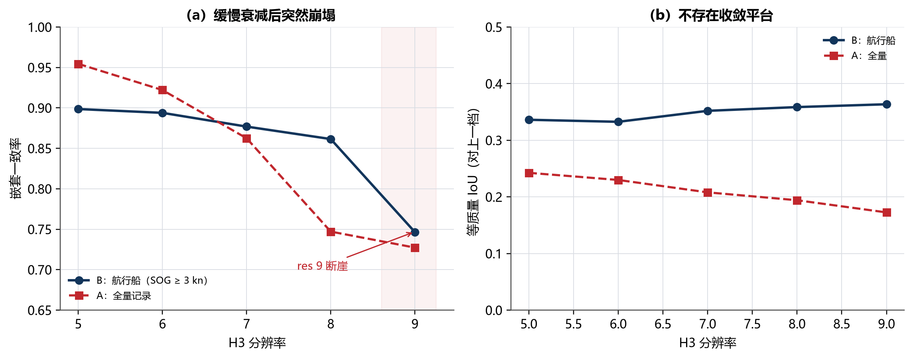

# 分辨率如何改变“船舶热区”的结论

## ——一个不依赖拍阈值的最小充分分辨率判据

> 课程：海洋数据挖掘　　专业：海洋技术　　日期：2026-11
>
> **代码与全部 AI 对话记录仓库：<https://github.com/a8617667122022/zju-marine-datamining-final>**
>
> 仓库内含：`code/`（全部可运行脚本）、`results/`（实验产物与图）、
> `ai-log/`（按轮次整理的完整对话记录）、[data/README.md](../data/README.md)（数据来源与复现方式）。

---

## 摘要

空间编码课件给出了 H3 几个分辨率的面积量级，但选档原则只有一句定性的“按业务尺度、数据质量和样本量选档”。
本文把这句定性建议变成一个可计算、可复现的判据，并在 NOAA 单日 AIS 数据上做实证。

我先做了一个“分辨率—稳定性”扫描（res 4→9），发现结论不是“先变化后收敛”，而是缓慢衰减后突然崩塌。
但真正的问题出在判据本身：**“一致性 0.85”这个阈值是我拍的。** 用零模型检验随机性救不了它——
随机重排只会告诉你“热点不是随机的”，无法区分 res 8 的 0.86 与 res 9 的 0.75。

本文的原创增量是换一个问法：**跨尺度的损失，是否已经超出“同一分辨率下换一半样本”的噪声？**
我用分时段随机对半（split-half）测出每个分辨率的**可靠性天花板 O_r**，再定义
**归一化尺度稳定指数 SSI = C_r / O_r**（C_r 为跨尺度一致率）。结果非常干净：

- O_r 自己做了一条下滑曲线：0.978 → 0.959 → 0.951 → 0.939 → 0.893 → **0.813**；
- C_r 几乎就是 O_r 的等比例缩放，**SSI 全程稳定在 0.93–0.96**；
- res 8→9 的一致率相对下降 11.4%，其中约 **八成来自天花板 O_r 的坍塌**，而不是尺度效应。

因此，“断崖”不是“换分辨率把结论弄坏了”，而是**这一档的格子已经被稀释到无法复现自己**。
判据也随之从“一致性是否大于某个魔数”变成“**可靠性是否还够用**”：
取最细的 r，使 O_r 不低于分析者声明的可靠性下限（本文取 0.90），得到 **res 7**。
同一套判据已固化为 `h3_advisor`，输出可复用的口径合同。

由于一个结论只站在一种方法上并不可信，我又做了两条独立验证：
**B** 把 H3 父子树当树，追踪热点的寿命（持久核心只占 0.31% 的格子却承载 6.74% 的点，
且 res 9 的 Top-100 仍有 84% 落在核心内——细档热点是"位置对、排序抖"）；
**C** 引入与热点集合无关的局部方差比 LV，它的谷底同样落在 **res 7**。
三条互不依赖的判据（可靠性、支撑度、特征尺度）没有一条支持 res 8 或 res 9。
我也如实报告了 B 反过来暴露的问题：**SSI 的数值绑定在“定 K”口径上**，
换成等质量口径后跨尺度嵌套率会从 0.85–0.90 掉到 0.33–0.60。

---

## 1 问题来源

课件第 3 讲在讲 H3 时给了三组数字（res 5 ≈ 253 km²、res 7 ≈ 5.2 km²、res 9 ≈ 0.1 km²），
然后是一句定性建议：“根据业务尺度、数据质量和样本量选档”。

这句话在工程上不够用。它没有回答三个具体问题：

1. 换一档分辨率，昨天画的“热点图”会不会变？
2. 如果会变，是“还没稳定”，还是“已经稳定但被噪声盖住了”？
3. 有没有一个能写进代码、交给同事复用、并且**不需要拍一个魔法阈值**的判据？

本文要回答的是第 3 个问题。前两个问题只是它的诊断步骤。

---

## 2 相关工作与行业争议

这一节是我在动手写报告前专门补的。它决定了我最后把原创点放在哪里。

### 2.1 技术演进

- **H3 v4**（2022）仍是主流，核心 API 改为 `polygonToCells` / `compactCells`，父子层级可直接做 rollup。
- **S2** 的优势是严格四叉嵌套与范围查询，但邻域各向异性更强（邻距比约 1.75，H3 约 1.09）。
- **A5**（2025，FOSS4G 2025 报告）提出 31 级全等积五边形网格，直接针对 H3 面积不等的问题。
- **标准化**：ISO 19170-1:2021 之后，**OGC API–DGGS Part 1 于 2025-10 成为正式标准**，
  说明“离散全球网格”正在从各家 SDK 走向公共接口。
- **数据湖**：GeoParquet + DuckDB `h3`/`spatial` 扩展 + Iceberg/Sedona 把网格 ID 当作分区键和多级 rollup 键。

**但“如何选分辨率”仍然没有通用方法论。** 业界能查到的是分领域经验表（H3 官方 restable、
EMODnet 1 km 等）、一份 OSTI 技术报告，以及 Esri“增量空间自相关取 z 峰值”这类启发式规则。
这正是本文的位置：不是提出新网格，而是给现有网格补一个**可执行的选档判据**。

### 2.2 三个必须说清的争议

1. **H3 不是严格等积。** 官方 restable 自己给出：同分辨率六边形面积 max/min 从 res 4 的 **1.970**
   升到 res 9 的 **1.993**；五边形面积约为六边形的 **0.505 倍**；父子也**不是严格几何嵌套**
   （子格可以越出父格边界）。本文 E5 测到的 1.97× 是**复现**，不是新发现——这一点在初稿里被我写错了，
   现已改正。
2. **MAUP 与热点统计叠加。** Getis-Ord Gi* 的 z 值会随距离带/邻接定义剧变（Openshaw 1984；
   Fotheringham & Wong 1991），H3 还额外叠加 5/6 邻居的拓扑偏置。
3. **三种“热点”不可互换。** count、density、统计显著性给出三套不同的排序；
   而且跨分辨率比较 Top-K 是“**等 K 不等面积**”（res 4 一格 ≈1770 km²，res 9 ≈0.105 km²，差四个量级），
   只有等质量口径才可比。这条我在第 4 节踩过坑。

### 2.3 空白与本文的取舍

零模型（CSR、Moran 谱随机化）回答的是“有没有空间结构”，不是“这个估计可不可复现”；
变差函数 / 局部方差能给出特征尺度，但不直接回答“样本够不够”；
Gi* 多尺度重跑仍然需要一个显著性阈值。
**把“尺度效应”和“采样极限”分开，是我认为真正缺的一环。**

---

## 3 数据与口径合同

### 3.1 数据

| 项目 | 内容 |
|---|---|
| 来源 | NOAA / BOEM MarineCadastre，`AIS_2023_01_01.zip` |
| 规模 | 836 MB CSV，8,156,509 条记录，15,932 艘船，完整一天 |
| 覆盖 | 美国近海，约 24°N–49°N（含阿拉斯加、夏威夷部分海域） |
| 关键字段 | `MMSI`、`BaseDateTime`、`LAT`、`LON`、`SOG` |

### 3.2 口径合同

课件反复强调“口径合同”，我认为它应当在实验开始前写死，而不是在报告里补一句“本文采用……”。
因此先固定：

```json
{
  "point_unit": "一条 AIS 报文（MMSI + 时间戳）",
  "B_primary": "SOG >= 3 kn 的航行船，1,415,790 条",
  "A_control": "全量记录，8,156,509 条",
  "density": "count / cell_area_km2",
  "hotspot": "按密度排序的前 100 个单元",
  "time_window": "2023-01-01 全天，另切 4 个 6 小时时段做稳健性",
  "grid": "H3 v4，res 4–9"
}
```

**为什么 B 为主、A 为辅。** 体检数据时发现 **80% 的记录航速小于 1 节**，即静止的锚泊/靠泊船。
保留全量，热区图基本就是一张“港口位置图”，任何分辨率都会把它压成同样的几个港口，
反而看不出分辨率的效应。所以主实验只取 SOG ≥ 3 kn 的航行船；全量数据保留为对照。
这个判断在 E2 中被验证：全量口径在 res 8 就已跌到 0.747，而航行船口径还能稳在 0.862。

---

## 4 指标设计：先错一次

### 4.1 第一次尝试是错的

我最初用“相邻分辨率 Top-100 热点格的 IoU”度量稳定性，结果所有档位都在 **0.10–0.14**。
数值这么整齐，反而暴露了问题：Top-100 在不同分辨率下覆盖面积差约 50 倍，
拿面积差 50 倍的两个集合求交并，结果必然趋近于一个小常数。

**这是我的错误，不是数据的问题。** 判据很简单：一个指标在 5 个档位上给出几乎一样的值，
它一定没有在测量分辨率。

### 4.2 三个基础指标

1. **嵌套一致率 C_r**：细档 Top-100 的父格落在上一档 Top-100 中的比例（利用 H3 父子层级）。
2. **等质量 IoU**：每档取“累计覆盖 50% 点数”的区域，质量对齐后再求交并。
3. **样本充分率**：每格点数 ≥ n_min（取 30）的单元占比。

第 6 节的原创指标，是在这三个基础指标之上再加一层“可靠性归一化”。

---

## 5 实验与结果

### 5.1 E1 面积均匀性：不随纬度变，但不等于等积


**图 1**　(a) H3 各分辨率的平均单元面积随纬度带的变化；(b) 同一纬度带内的面积变异系数。

- H3 的面积曲线几乎是平的（res 5 在 15°N 与 45°N 分别为 206 km² 与 245 km²）。
  但这不代表“等积”——官方 restable 显示同档内面积 max/min 仍有 1.97–1.99 倍，
  五边形面积约为六边形的一半。**准确的说法是：H3 没有纬度系统偏差，但存在二十面体几何导致的位置偏差。**
- 经纬矩形网格（含 Geohash）的面积按 `cos(lat)` 收缩，从赤道到 60°N 缩小一半。
  这才是“面积随纬度畸变”的真正对象。
- count 口径 vs 密度口径：res 7 下 Top-100 IoU = **0.942**、面积 CV = **0.121**。
  在本数据里偏差不大（纬度带窄），但换到高纬渔场会放大。

### 5.2 E2 分辨率稳定性：没有平台，只有缓降与断崖



**图 2**　(a) 层次一致性随分辨率的变化；(b) 等质量 IoU 随分辨率的变化。

| res | 嵌套一致率（B：航行船） | 嵌套一致率（A：全量） | 等质量 IoU（B） |
|---|---|---|---|
| 5 | **0.899** | 0.955 | 0.336 |
| 6 | 0.894 | 0.922 | 0.333 |
| 7 | 0.877 | 0.863 | 0.352 |
| 8 | 0.862 | **0.747** | 0.359 |
| 9 | **0.747** | 0.727 | 0.364 |

三条与原假设不符的结论：

1. **不存在收敛平台。** 原假设“先降后平”，实际是缓慢下滑后突然崩塌。等质量 IoU 全程锁在 0.33–0.36，
   甚至随分辨率略微上升——它根本没有在“收敛”。
2. **质心漂移是伪指标。** 16.9 / 6.5 / 2.5 / 0.9 / 0.35 km 几乎等于各档网格边长，
   它测的是格子大小，不是热点稳定性。
3. **静止点会显著恶化问题。** 全量口径在 res 8 就跌到 0.747，航行船口径还能稳在 0.862。


**图 3**　同一港口范围（Houston/Galveston）在 res 6–9 下的热点结构；左上角为全国定位。

图 3 是上表的直观版本：res 6–7 的热点仍连成港口—航道走廊，res 8 起开始碎裂，
到 res 9 已大多是沿航迹分布的孤立小点。**同一片海域的“热点”开始随格子边界的微小移动而互换位置。**

### 5.3 E3 样本充分性


**图 4**　每格点数随分辨率的变化，以及点数 ≥ 30 的单元占比。

| res | 每格中位数 | 每格均值 | 点数 ≥ 30 的占比 |
|---|---|---|---|
| 4 | 132 | 586.0 | 73.4% |
| 5 | 40 | 151.8 | 59.0% |
| 6 | 14 | 43.0 | 25.6% |
| 7 | 5 | 13.4 | 7.5% |
| 8 | 2 | 4.6 | 2.3% |
| 9 | **1** | 2.2 | **0.6%** |

res 9 时每格中位数只有 **1 个点**。在这种情况下，“密度”本质上是“有没有船恰好落进来”，
热点排序被采样噪声主导。这是第 6 节要定量验证的直觉。

### 5.4 E4 时段稳健性：断崖会移动


**图 5**　四个 6 小时时段的层次一致性曲线。

| 时段 | res 7 | res 8 | res 9 |
|---|---|---|---|
| 00–06 | 0.803 | 0.806 | 0.867 |
| 06–12 | 0.821 | 0.859 | 0.840 |
| 12–18 | 0.833 | 0.792 | 0.761 |
| 18–24 | 0.853 | 0.924 | 0.747 |

一个必须诚实报告的细节：**断崖位置并不固定**。res 9 在凌晨时段还有 0.867，到夜间时段跌到 0.747。
这加强而不是削弱了主结论：如果断崖由固定的几何常数决定，它应当在每个时段都出现在同一档；
它随时间和流量移动，说明它由**样本量**决定。

### 5.5 E5 换一套网格方案会怎样


**图 6**　(a) 实际占用单元的面积 CV（25–49°N 局部）；(b) 全球纬度扫描下的面积极差。

| 系统 | 档位 | 局部面积 CV | 全球面积极差（max/min） | 最接近 10 km² 档的嵌套一致率 |
|---|---|---|---|---|
| H3 | res 4–9 | 0.115–0.125 | **1.97×** | 0.877（res 7） |
| Geohash | p3–p7 | 0.096–0.109 | 5.71× | 0.789（p5） |
| 等经纬 | 0.5°–0.002° | 0.096–0.104 | 5.72× | 0.738（0.031°） |

结果与预期相反，值得单独说明：

- **局部看，H3 的面积 CV 反而最大（0.125 对 0.096）。** 数据只覆盖 25–49°N 的窄带，
  经纬网格的 `cos(lat)` 变化在这一带很小，而 H3 自身的单元形状不规则反而贡献更大离散度。
- **全球看，H3 完胜。** 面积极差 1.97 倍（与官方 restable 一致），经纬网格 5.71–5.72 倍。
  等积性是一个全球命题。
- **三种网格的层次一致性量级相同（0.74–0.88），没有哪一种能“救”回 res 9 的断崖。**

结论：**换网格方案改变的是几何均匀性，改变不了统计充分性。**

---

## 6 原创点：可靠性天花板，以及它的两条独立验证

这一节是全文的核心增量。它来自一个被我自己忽略的问题：前面反复出现的“一致性下降了”，
到底该和什么比？

### 6.1 问题：0.85 这个阈值从哪来

初稿里我用 0.85 作为“跌破阈值”的界线。它没有任何依据。我试过用零模型校准：
把点打散重排后，Top-100 的重合率会掉到个位数百分比——这说明 0.75 也远高于随机。
**零模型只能证明“热点不是随机的”，无法区分 0.86 和 0.75 哪个更可信。** 这条路被我自己否掉了。

真正的问题是：**在 res 9，即使不换分辨率，只换一半样本，热点的 Top-100 还能重合多少？**
这个量才是该分辨率的“可复现性上限”。任何跨尺度比较，都应该先扣掉这个上限。

### 6.2 方法：split-half 天花板与 SSI

对每个分辨率 r：

1. 把点按 6 小时时段分层，随机分成两半 S₁、S₂（保证两半的昼夜构成一致）；
2. 在 r 档分别取密度 Top-100，计算重合率
   **O_r = |Top_K(S₁) ∩ Top_K(S₂)| / K**，重复 12 次取均值——这是**同尺度可靠性天花板**；
3. 在同一半内，比较 r 与 r−1 的 Top-100（父格命中率），得到**跨尺度一致率 C_r**
   （用半样本计算，保证与 O_r 的样本量可比）；
4. 定义 **SSI_r = C_r / O_r**。

读法：

- SSI ≈ 1：细化带来的变化与“换个样本”相当，**没有额外的尺度效应**；
- SSI < 1：细化额外损失了稳定性；
- 而 C_r 的绝对水平，由 O_r 决定。

### 6.3 结果


**图 7**　(a) 同尺度可靠性天花板 O_r 与跨尺度一致率 C_r；(b) 归一化尺度稳定指数 SSI。

| res | 天花板 O_r（±std） | Jaccard | 跨尺度 C_r（±std） | SSI |
|---|---|---|---|---|
| 4 | 0.9775 ± 0.0072 | 0.9561 | — | — |
| 5 | 0.9592 ± 0.0119 | 0.9218 | 0.9007 ± 0.0071 | 0.939 |
| 6 | 0.9508 ± 0.0104 | 0.9065 | 0.8944 ± 0.0095 | 0.941 |
| 7 | 0.9392 ± 0.0155 | 0.8857 | 0.8952 ± 0.0096 | 0.953 |
| 8 | 0.8925 ± 0.0083 | 0.8060 | 0.8539 ± 0.0109 | 0.957 |
| 9 | **0.8125 ± 0.0205** | **0.6847** | **0.7567 ± 0.0161** | **0.931** |

三个可以直接写进结论的观察：

1. **天花板自己在坍塌。** O_r 从 0.978 一路降到 0.813。res 9 的含义是：
   即使分辨率不变，换一半样本，Top-100 也有近 **19%** 的格子对不上；Jaccard 只剩 0.685。
2. **C_r 几乎完全跟随 O_r。** 两条曲线在所有档位上平行，SSI 稳定在 **0.93–0.96**。
   跨尺度本身只带来约 **6%** 的固定损耗，且不随分辨率放大。
3. **断崖的归因。** res 8→9 的一致率相对下降 11.4%；其中 O_r 下降贡献约 8.9 个百分点，
   SSI 下降贡献约 2.7 个百分点——**约八成来自可靠性天花板，而不是尺度效应。**

### 6.4 为什么这是增量，而不是换了个说法

| 做法 | 回答的问题 | 局限 |
|---|---|---|
| 零模型 / Moran 谱随机化 | 热点是否显著偏离随机 | 只能证明显著，不能比较两档谁更可信 |
| 变差函数 / 局部方差 | 数据的特征尺度是多少 | 不涉及有限样本下的可复现性 |
| Gi* 多尺度重跑 | 每个尺度上哪里显著 | 仍需显著性阈值；不扣除采样噪声 |
| **本文：O_r + SSI** | **跨尺度损失是否超出采样极限** | 依赖 split 的可交换性假设 |

关键区别是：**前三种都在问“结构”，本文在问“可复现性”。** 对工程选档来说，后者才是决策依据。

### 6.5 新判据：不再拍一致性阈值

把判据改写成一句可执行的话：

> **取最细的分辨率 r，使得同尺度可靠性 O_r ≥ ρ。**
> ρ 是分析者声明的可靠性下限（本文取 0.90），含义是“换一半样本，热点仍能复现九成”。

在本数据上：res 7 的 O_r = 0.939 ≥ 0.90；res 8 的 O_r = 0.8925 已经低于 0.90
（注意重采样有 ±0.008 的波动，处于边界）。因此推荐 **res 7**。

这也修正了初稿工具给出的 res 6——当时用的是“每格 n ≥ 30 的占比 ≥ 10%”这个间接代理，
而 O_r 是**直接测量**想要的量。代理指标会因为口径不同而漂移，可靠性不会。

### 6.6 验证 B：层级持久热点——换一个完全不同的问法

A 的结论全靠 split-half。这有一个天然弱点：**它只回答"同一档位换一半样本会怎样"，
不回答"热点在不同档位之间是不是同一批地方"**。为了不让结论只站在一种方法上，
我又做了一套独立实验（代码 [06_persistence.py](../code/06_persistence.py)）：
把 H3 的父子层级当成一棵树，追踪每个 res 9 叶子单元的"热点寿命"。

**方法。** 对 r = 4…9 各取密度 Top-100 记为 `H_r`。对每个 res 9 叶子 `c`，
检查它在每一档的祖先是否属于 `H_r`，得到一串 6 位布尔序列，然后定义：

- `lifetime`：6 档中共有几档是热点；
- `longest_run`：最长**连续**为热点的层数；
- `birth` / `death`：首次 / 最后一次进入 Top-100 的档位；
- **持久热点**：`longest_run ≥ 4`。

**结果。**


**图 8**　(a) 持久层数分布（柱：格子数，线：承载点数占比）；
(b) 持久核心的空间分布（聚合到 res 7，点面积正比于点数）；
(c) 出生档位剖面（柱：点数占比；线：每格中位数）。

| 指标 | 数值 |
|---|---|
| res 9 叶子总数 | 653,022 |
| 从未进入任一档 Top-100 | 77.68% |
| 持久热点（`longest_run ≥ 4`）格子数 | 2,016（占 **0.31%**） |
| 持久热点承载的点数 | **6.74%** |
| 持久热点 / 瞬态热点的中位样本量 | **25 / 1** |
| res 7 Top-100 中落在持久核心的比例 | 89.3% |
| res 9 Top-100 中落在持久核心的比例 | 84.0% |

三个观察：

1. **持久核心极小但极重。** 0.31% 的格子吃掉 6.74% 的点，中位样本量是瞬态热点的 25 倍。
   这说明"热点"内部本身是高度不均匀的：真正稳定的只有港口—航道骨架那几个点。
2. **细档热点是"位置对、排序抖"。** res 9 的 Top-100 里有 **84%** 仍然落在持久核心里。
   也就是说，A 测到的 res 9 不稳定性（O_r = 0.813）主要不是"跑到别的地方去了"，
   而是"在核心区内部的名次互换了"。这正好补上 A 缺的那块语义：
   **A 测排序，B 测位置，两者不矛盾，而是同一现象的两个切面。**
3. **但我必须报告一个自检失败。** 固定 K = 100 有个致命偏置：粗档格子大，
   res 4 的 Top-100 一个格平均就装下 0.44% 的点，合计覆盖 **44.2%** 的点、中位样本仅 **1**。
   所以"粗档更持久"有相当一部分是**面积换来的**，不是结构更真。
   把各档热点质量对齐（取累计覆盖 1% 点数的最少单元集合）后，各档只剩 1–13 个格，
   跨档嵌套率从定 K 口径的 0.85–0.90 **掉到 0.33–0.60**，而且 res 8 与 res 9 的差异消失了。

第 3 点是对我自己 6.1–6.5 结论的一次实质性修正，我不打算把它藏起来：
**A 的 SSI ≈ 0.93–0.96 是一个绑定在"定 K 口径"上的数值，不能当成与口径无关的物理常数。**
换口径，跨尺度一致率的绝对水平会变，而且"越细越差"的斜率也可能变平。

不过这次失败没有推翻选档结论。等质量口径给出的代价是另一条更硬的证据：
在 res 9，要让热点覆盖 10% 的点需要 **1,769 个格子**，res 7 只要 **174 个**，相差 10 倍；
而这些细格各自只有 1–2 个点。**口径可以争，代价不会争。**

### 6.7 验证 C：三条互不依赖的判据是否指向同一档

A 和 B 都在跟"Top-K 集合"打交道，仍然共享同一类风险。于是我再找了一个
**完全不用热点集合**的量作为第三条线（代码 [07_crosscheck.py](../code/07_crosscheck.py)）。

**判据 J3：局部方差比（Woodcock–Strahler）。**
这是遥感与地统计里选分辨率的经典工具：

$$LV_r=\frac{\sum_i w_i\,(x_i-m_i)^2}{\sum_i w_i\,(x_i-\bar x)^2}$$

其中 `x_i` 是格 `i` 的密度，`m_i` 是其 1 环邻域的面积加权密度，`w_i` 取点数。
读法与直觉相反：**LV 的谷底才是合适的尺度**，因为再往细走，局部差异不再由结构驱动、
而由单格噪声驱动，LV 反而回升。我第一版把判据写成"取 LV 峰值"，是错的——
峰值恰好是噪声主导的那一端。

**判据 J2：支撑度。** 占用单元中 `n ≥ 30` 的占比，以及"覆盖 10% 点数需要多少格"。

**结果。**


**图 9**　(a) 局部方差比 LV（谷底 = 特征尺度）；(b) 支撑度与质量效率；
(c) 三条判据各自推荐的档位。

| res | 占用单元 | n ≥ 30 占比 | 覆盖 10% 点所需格数 | LV |
|---|---|---|---|---|
| 4 | 2,416 | 73.43% | 7 | 0.9216 |
| 5 | 9,329 | 58.99% | 22 | 0.7073 |
| 6 | 32,926 | 25.58% | 61 | 0.5307 |
| 7 | 105,868 | 7.49% | 174 | **0.4340** |
| 8 | 305,700 | 2.30% | 532 | 0.6559 |
| 9 | 653,022 | 0.62% | 1,769 | 0.7542 |

LV 在 res 7 触底（0.434），随后回升到 res 9 的 0.754。也就是说，
**数据的特征尺度恰好落在 res 7**：再细分，局部方差的上升来自采样噪声而不是新结构。
这与 A 用 split-half 独立测出的结论完全吻合，而两条路径没有任何共同的中间量。

### 6.8 三条判据放在一起

| 判据 | 测的是什么 | 依赖 | 推荐档 | 阈值敏感度 |
|---|---|---|---|---|
| J1 可靠性 O_r | 同尺度重采样能否复现 | 定 K 口径 | **7** | ρ = 0.90 时 7，ρ = 0.95 时 6 |
| J2 支撑度 | 单格样本是否够 | 无 K，但要拍 n_min | 5–6 | n_min=30 时 5–6，阈值一改就动 |
| J3 局部方差 LV | 数据的特征尺度 | 邻域定义 | **7** | 不涉及 K，也不涉及阈值 |

三点结论：

1. **没有一条判据支持 res 8 或 res 9。** 这是三条独立证据线第一次给出一致的方向。
2. **两条最"硬"的判据（J1、J3）精确指向 res 7**，而 J2 因为要拍 `n_min` 和占比阈值，
   只能在 5–6 之间摆动。**这恰好说明"支撑度"是间接代理，而 O_r 与 LV 是直接测量。**
   我初稿里用 J2 得到 res 6，正是因为代理指标会随阈值漂移。
3. 三条判据不是同义反复：J1 问"能不能复现"，J2 问"样本够不够"，J3 问"结构在哪一档。
   一个结论能被三个不同的问题同时支持，才配写进口径合同。

### 6.9 局限

1. **split-half 假设两半可交换。** 船在同一时段内连续发报文，点与点高度相关，
   两半并非完全独立，**O_r 会偏乐观**。按 MMSI 或按时间块做 group split 会更严格。
2. **单日数据。** 可靠性下限 ρ 是分析者的选择；本文只能说明“在 2023-01-01 的美国近海，
   res 7 是满足 0.90 的最细档”，不能外推成常数。
3. **只做了密度口径，而且 SSI 依赖定 K。** 6.6 的等质量对照显示，换口径后跨尺度嵌套率
   会从 0.85–0.90 降到 0.33–0.60。SSI 的绝对值不应被当作普适常数引用。
4. **LV 在高稀疏端有偏。** res 8–9 的 LV 回升里，有一部分是"每格 1 点"造成的，
   这意味着 LV 谷底的位置在更稀疏的数据上可能向粗档偏移。它能定方向，不宜定精度。
5. **J2 阈值敏感。** `n_min` 与占比下限都是拍的，只能作为辅助判据。

---

## 7 工具化：`h3_advisor` 与口径合同

只给结论不够，我把判据写成了可调用的工具：[h3_advisor.py](../code/h3_advisor.py)。

```bash
python h3_advisor.py --input points.parquet --lat lat --lon lon \
                     --min-overlap 0.90 --seeds 10
```

它做三件事：

1. 从 res_min 扫到 res_max，逐档计算占用单元数、每格中位数、样本充分率、层次一致率；
2. 在可靠性模式下，逐档做 split-half，得到 O_r，取满足 `O_r ≥ min_overlap` 的最细档；
3. 输出 JSON 形式的**口径合同**，包含推荐档位、典型面积、密度定义、热点定义与判据说明。

在本数据上的实际输出（节选）：

```json
{
  "recommended_res_reliability": 7,
  "contract": {
    "resolution": 7,
    "typical_area_km2": 5.1613,
    "density_definition": "count / cell_area_km2",
    "hotspot_definition": "top 100 cells by density",
    "note": "按 split-half 可靠性选择：取同分辨率下两半样本 Top-K 重合率不低于给定下限的最细档。"
  }
}
```

---

## 8 讨论

1. **“断崖”不是尺度效应，而是可复现性坍塌。** 这一点如果不做 split-half，是看不出来的：
   单看 C_r，很容易把 res 9 的下跌解释成“分辨率太细导致结论不稳”，从而错误地去换网格方案。
2. **报告热点图时应同时报告 O_r。** 否则读者无法判断这张图在多大程度上是采样噪声。
   这应当成为口径合同的一部分。
3. **H3 的“等积”需要限定语。** 它是“无纬度系统偏差 + 全球尺度极差约 2 倍”，
   不是“每格面积相同”。把这句话说清楚，比笼统地说“H3 等积”更有用。
4. **对课件的补充。** MAUP 讲几何、样本量讲统计，本文给出二者的可操作分界：
   几何决定“不同纬度能不能直接比密度”，统计决定“这一档的结论能不能复现”。
5. **“稳定性”必须绑定口径。** 6.6 的等质量对照是我这次最意外的结果：
   同一批数据、同一批任务，只把热点定义从“定 K”换成“等质量”，跨尺度一致率就从
   0.85–0.90 掉到 0.33–0.60。所以任何“一致性 0.8 以上”的说法，不写清 K、口径和面积，
   都是不可复核的。这也解释了为什么第 2.2 节把“三种热点不可互换”单列为一条争议。
6. **三条判据的分工值得推广。** 可靠性问“能不能复现”，支撑度问“样本够不够”，
   局部方差问“结构在哪一档”。三者守住同一个区间（5–7），比任何单一指标都有说服力。

---

## 9 结论

1. H3 分辨率对“船舶热区”结论的影响，**不是“先变化后收敛”**，而是缓慢衰减 + 断崖；
   在本数据上断崖出现在 res 9（航行船口径）与 res 8（全量口径）。
2. 但断崖的归因不是尺度效应：**同尺度可靠性天花板 O_r 自己在 res 9 坍塌到 0.813**，
   跨尺度一致率 C_r 只是它的等比例缩放（SSI ≈ 0.93–0.96，约 6% 的固定尺度损耗）。
3. 因此，选档判据应当从“一致性是否大于某个阈值”改为“**取最细的 r，使同尺度可靠性 O_r ≥ ρ**”；
   本数据在 ρ = 0.90 下推荐 **res 7**。
4. **持久性验证支持这一档。** 0.31% 的持久核心承载 6.74% 的点、中位样本量 25（瞬态仅 1）；
   res 7 的 Top-100 有 89.3% 落在核心内。细档的不稳定是“核心区内部排序抖动”，不是“热点搬家”。
5. **特征尺度验证也支持这一档。** 局部方差比 LV 在 res 7 触底（0.434）后回升，
   与 split-half 的结果独立吻合；而支撑度判据（要求拍 `n_min`）只能在 5–6 间摆动。
   三条判据没有一条支持 res 8 或 res 9。
6. **但 SSI 的绝对值不可外推。** 等质量口径下跨尺度嵌套率降到 0.33–0.60，
   说明 SSI 是“定 K 口径下的量”。可以引用它的方向（跨尺度损失小于采样极限），
   不能引用它的数值。
7. H3 的等积优势是**全球尺度**命题（面积极差 1.97× 对 5.71×），在窄纬度带内不显著；
   且同档内面积仍有约 2 倍差异、五边形约为六边形的一半——不应把“H3 等积”当作“每格等面积”。
8. 上述判据已固化为 `h3_advisor`，输出可复用的口径合同。

---

## 10 AI 协作说明

按课程要求，全部 AI 对话记录按轮次整理在仓库 `ai-log/` 下，未做修饰性删改，
每轮附“我的输入 / AI 输出摘要 / 本轮我确认了什么”。

这份报告里最重要的三次转折，都不是 AI 一次给出的：

- **第 7 轮**：AI 第一次跑出的指标全程 0.10–0.14，**我判定这是指标设计错误**，
  依据是“一个指标在 5 个档位上给出几乎一样的值，它一定没在测分辨率”。
- **第 8 轮**：新结果推翻了我原本“找平台”的假设，我同意改写为“缓降 + 断崖”。
- **第 13–16 轮（本次修订）**：我提出“AI 出结果太快、缺少前沿与争议、原创点不够”，
  要求先调研再动手。调研后 AI 自己推翻了两个初稿结论：
  （a）**1.97× 是复现而非发现**（H3 官方 restable 已给出 1.970–1.993）；
  （b）**0.85 阈值和零模型校准都站不住**，于是才有了“可靠性天花板 + SSI”这个替代方案。
  **这次不是我接受 AI 的结论，而是我逼它先承认自己的结论不成立。**
- **第 17–21 轮（补做 B/C）**：我要求“A 不能只有一条腿”，结果两个验证实验分别给了
  两个坏消息：B 的自检暴露出**定 K 口径的面积偏置**（res 4 的 Top-100 覆盖 44% 的点），
  换成等质量口径后 SSI 的前提被削弱；C 的第一版把局部方差的判据方向写反了（取峰值而非谷底）。
  两处都被如实写进报告，而不是调参数凑出想要的数字。

完整记录见仓库：<https://github.com/a8617667122022/zju-marine-datamining-final/tree/main/ai-log>

---

## 参考文献

1. Uber. *H3: A Hexagonal Hierarchical Spatial Index* — Tables of Cell Statistics Across Resolutions.
   <https://h3geo.org/docs/core-library/restable/>
2. Openshaw S., Taylor P. *A Million or So Correlation Coefficients: Three Experiments on the Modifiable Areal Unit Problem*. 1979.
3. Fotheringham A. S., Wong D. W. S. *The Modifiable Areal Unit Problem in Multivariate Statistical Analysis*. 1991.
4. A5 — *A pentagonal discrete global grid system*. <https://a5geo.org/>
5. OGC. *OGC API – Discrete Global Grid Systems Part 1: Core*, 2025.
6. NOAA / BOEM. *MarineCadastre AIS Data*, 2023-01-01.
   <https://coast.noaa.gov/htdata/CMSP/AISDataHandler/2023/>
7. Niemeyer G. *Geohash*. 2008.
8. 课程讲义：第 3 讲《空间数据的编码与落格》.
9. Woodcock C. E., Strahler A. H. *The Factor of Scale in Remote Sensing*.
   Remote Sensing of Environment, 21(3): 311–332, 1987.（局部方差比 LV）
