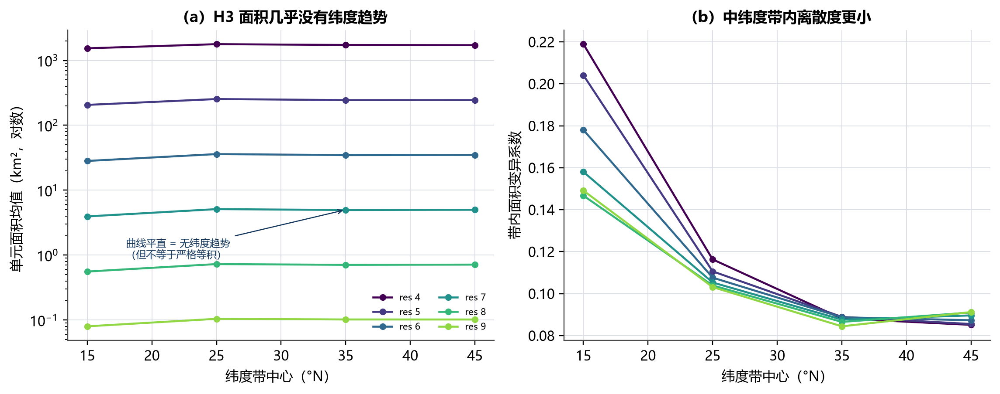
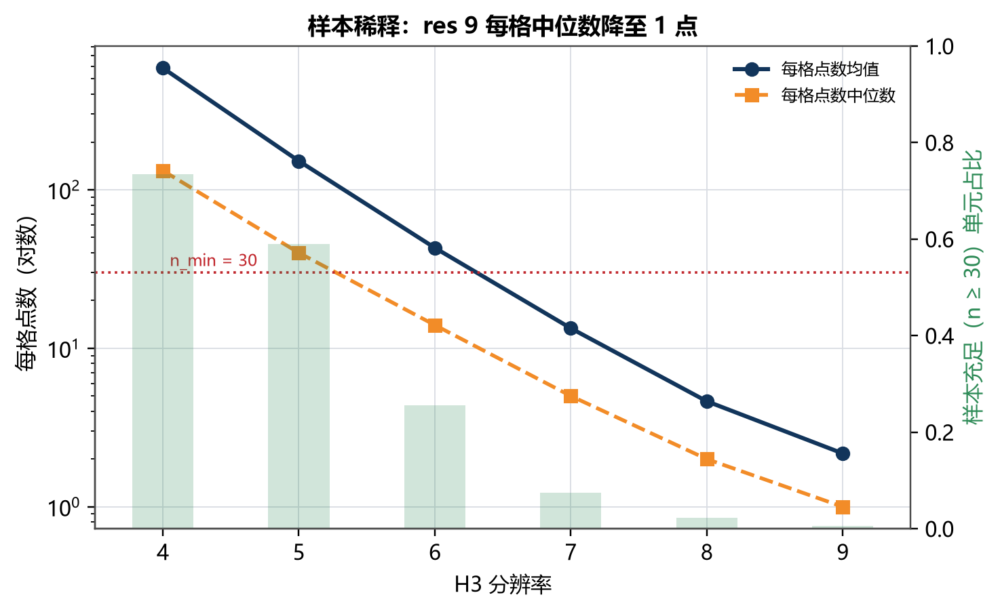
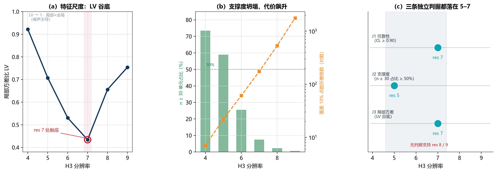

# 分辨率如何改变“船舶热区”的结论

## ——一次以“提问方式”为对象的实验记录

> 课程：海洋数据挖掘　　专业：海洋技术　　日期：2026-11
>
> **代码与全部 AI 对话记录仓库：<https://github.com/a8617667122022/zju-marine-datamining-final>**
>
> 仓库内含：`code/`（全部可运行脚本）、`results/`（实验产物与图）、
> `ai-log/`（按轮次整理的完整对话记录）、[data/README.md](../data/README.md)（数据来源与复现方式）。

**关于这份报告的写法。** 它不按论文顺序写，而按我实际的推进顺序写。
文中凡出现「我当时以为」的地方，都是后来被数据或我自己推翻的判断。
之所以保留这些弯路，是因为它们才是这次作业真正的产出：
**我改的不是参数，是提问方式。**

---

## 摘要

空间编码课件给出了 H3 各分辨率的面积量级，但选档只有一句定性的
“按业务尺度、数据质量和样本量选档”。我想把它变成一条能写进代码的判据。
这个过程我失败了三次，每次失败都推翻了一个我原本很确信的东西：

1. **第一版指标失效。** 我用相邻档 Top-100 的 IoU 度量稳定性，5 个档位全在 0.10–0.14。
   数值这么整齐，说明它测的不是分辨率，而是面积差。
2. **假设被推翻。** 我以为曲线会“先变化、后收敛”。实际是缓慢衰减 + 断崖，
   根本没有平台。
3. **判据本身站不住。** “一致性跌破 0.85”里的 0.85 是我拍的；想用零模型校准，
   发现零模型只能证明“热点不是随机的”，无法区分 0.86 与 0.75 谁更可信。

真正的转折不是换指标，而是换问题。我不再问“跨尺度一致率多少算好”，
改问：**这一档的分辨率，自己能做到多好？**

用分时段随机对半测出每个档位的**可靠性天花板 O_r**，再定义
**归一化尺度稳定指数 SSI = C_r / O_r**。结果非常干净：

- O_r 自己做了一条下滑曲线：0.978 → 0.959 → 0.951 → 0.939 → 0.893 → **0.813**；
- C_r 几乎是 O_r 的等比例缩放，SSI 全程稳定在 0.93–0.96；
- res 8→9 的一致率相对下降 11.4%，其中约八成来自天花板坍塌，而不是尺度效应。

判据因此变成：**取最细的 r，使 O_r 不低于分析者声明的可靠性下限**（本文取 0.90），得到 res 7。

定稿前我又对 A 做了两次自我攻击：用 H3 父子树的“热点寿命”验证（B），
用完全不碰 Top-K 的局部方差比验证（C）。B 没有替我撑腰，反而先捅破了我的口径前提
（固定 K 下 res 4 的 Top-100 覆盖了 44% 的点）；C 的第一版我把判据方向写反了，改正后
LV 谷底同样落在 res 7。三条互不依赖的判据没有一条支持 res 8 或 res 9。

---

## 1 起点：课件里一句没法执行的话

第 3 讲讲 H3 时给了三组数字（res 5 ≈ 253 km²、res 7 ≈ 5.2 km²、res 9 ≈ 0.1 km²），
然后是一句定性建议：“根据业务尺度、数据质量和样本量选档”。

这句话在工程上没法直接用。我把它拆成三个能动手的问句：

1. 换一档分辨率，昨天画的“热点图”会不会变？
2. 如果会变，是“还没稳定”，还是“已经稳定但被噪声盖住了”？
3. 有没有一个能写进代码、交给同事复用、**并且不需要拍一个魔法阈值**的判据？

**我当时的判断：** 第 3 个才是真问题，前两个只是诊断步骤。
现在回看，这个判断是对的；但我紧接着犯了一个错——**我把“答案长什么样”提前定了**。

---

## 2 第一次动手：我带着一个错误假设

我想要的图很具体：横轴分辨率，纵轴某个“稳定性”指标，曲线先下降，然后走平。
平台出现的位置就是合适的档位。这是很自然的工程直觉：如果结论稳定，曲线应该收敛。

第一版指标是**相邻两档 Top-100 热点格的 IoU**。
理由是它最直接：热点集合重合多少，结论就变了多少。

结果：res 5→6 是 0.10，6→7 是 0.12，7→8 是 0.13，8→9 是 0.11。

**五个档位，几乎同一个数。** 我第一反应是“数据有问题”，去查了落格、查了密度定义、
查了 Top-K 的排序方式，都没问题。

---

## 3 我否掉自己的第一版指标（第 7 轮）

真正让我停下来的，是一个很朴素的判据：

> **一个指标在 5 个档位上给出几乎一样的值，它一定没有在测量分辨率。**

我算了一下面积：res 4 一格 ≈ 1770 km²，res 9 ≈ 0.105 km²，差四个量级；
同样取 100 格，覆盖面积差约 50 倍。拿面积差 50 倍的两个集合求交并，
结果必然趋近于一个小常数。**这不是数据的问题，是我的问题。**

我给自己加了两条约束，重做指标：

1. 必须用上 H3 的父子关系（否则等于没用这个网格的特性）；
2. 必须把面积差异对齐（否则还是在测面积，不是测分辨率）。

于是有了三个基础指标：

| 指标 | 定义 | 解决的问题 |
|---|---|---|
| 嵌套一致率 C_r | 细档 Top-100 的父格落在上一档 Top-100 中的比例 | 利用层级，天然面积可比 |
| 等质量 IoU | 每档取“累计覆盖 50% 点数”的区域再求交并 | 质量对齐 |
| 样本充分率 | 每格点数 ≥ 30 的单元占比 | 直接看采样极限 |

**这一轮我学到的东西：** 指标失效时，先问“它到底在测什么”，而不是先调参数。
如果当时我去调 Top-K 的 K，很可能把 0.10 调到 0.15 就收工了，然后写一篇错的报告。

---

## 4 结果推翻了我的假设（第 8 轮）

新指标跑出来的曲线，和我预想的完全不一样。


**图4.1**　(a) 层次一致性随分辨率的变化；(b) 等质量 IoU 随分辨率的变化。

| res | 嵌套一致率（B：航行船） | 嵌套一致率（A：全量） | 等质量 IoU（B） |
|---|---|---|---|
| 5 | **0.899** | 0.955 | 0.336 |
| 6 | 0.894 | 0.922 | 0.333 |
| 7 | 0.877 | 0.863 | 0.352 |
| 8 | 0.862 | **0.747** | 0.359 |
| 9 | **0.747** | 0.727 | 0.364 |

三条与原假设不符的结论：

1. **不存在收敛平台。** 曲线是缓慢下滑，然后在 res 9 突然掉下去。等质量 IoU 全程锁在
   0.33–0.36，甚至随分辨率略微上升——它根本没有在“收敛”。
2. **我一度想用的“质心漂移”是伪指标。** 16.9 / 6.5 / 2.5 / 0.9 / 0.35 km
   几乎等于各档网格边长。它测的是格子多大，不是热点稳不稳。这是我第二次自我否决。
3. **静止船会显著恶化问题。** 全量口径在 res 8 就跌到 0.747，航行船口径还能稳在 0.862。
   这也确认了我“B 为主、A 为辅”的口径选择是对的。


**图4.2**　同一港口范围（Houston/Galveston）在 res 6–9 下的热点结构；左上角为全国定位。

图4.2 是上表的直观版本：res 6–7 的热点仍连成港口—航道走廊，res 8 起开始碎裂，
到 res 9 已大多是沿航迹分布的孤立小点。**同一片海域的“热点”开始随格子边界的微小移动而互换位置。**

在把“断崖”当结论之前，我必须先排除四个更平庸的解释。

### 4.1 会不会只是“面积随纬度变了”？（E1）



**图4.3**　(a) H3 各分辨率的平均单元面积随纬度带的变化；(b) 同一纬度带内的面积变异系数。

- H3 的面积曲线几乎是平的（res 5 在 15°N 为 206 km²，45°N 为 245 km²）。
  **但这不代表“等积”**：官方 restable 显示同档内面积 max/min 仍有 1.97–1.99 倍，
  五边形面积约为六边形的 0.505 倍。
- 准确的说法是：**H3 没有纬度系统偏差，但存在二十面体几何导致的位置偏差。**
- 经纬矩形网格（含 Geohash）才是真正“面积随纬度畸变”的对象，按 `cos(lat)` 收缩。
- count 口径 vs 密度口径：res 7 下 Top-100 IoU = **0.942**、面积 CV = **0.121**。
  本数据纬带窄，偏差不大；换到高纬渔场会放大。

**我当时差点在这里犯错。** 初稿把“面积极差 1.97×”写成了我的发现。
后来查 H3 官方 restable 才发现 1.970–1.993 是官方自己给的数——**我做的是复现。**
这条更正发生在第 13 轮，也是我后来坚持先做文献调研的原因。

### 4.2 每格到底还剩几个点？（E3）



**图4.4**　每格点数随分辨率的变化，以及点数 ≥ 30 的单元占比。

| res | 每格中位数 | 每格均值 | 点数 ≥ 30 的占比 |
|---|---|---|---|
| 4 | 132 | 586.0 | 73.4% |
| 5 | 40 | 151.8 | 59.0% |
| 6 | 14 | 43.0 | 25.6% |
| 7 | 5 | 13.4 | 7.5% |
| 8 | 2 | 4.6 | 2.3% |
| 9 | **1** | 2.2 | **0.6%** |

res 9 时每格中位数只有 **1 个点**。在这种情况下，“密度”本质上是“有没有船恰好落进来”。
这是我第一次明确意识到：断崖可能不是几何问题，是样本问题。第 6 节的 O_r 就是为了把这句话变成数。

### 4.3 断崖会不会只是某个时段的现象？（E4）


**图4.5**　四个 6 小时时段的层次一致性曲线。

| 时段 | res 7 | res 8 | res 9 |
|---|---|---|---|
| 00–06 | 0.803 | 0.806 | 0.867 |
| 06–12 | 0.821 | 0.859 | 0.840 |
| 12–18 | 0.833 | 0.792 | 0.761 |
| 18–24 | 0.853 | 0.924 | 0.747 |

**断崖位置并不固定。** res 9 在凌晨还有 0.867，到夜间跌到 0.747。
这加强而不是削弱了主结论：如果断崖由固定的几何常数决定，它应该每个时段都出现在同一档；
它随时间和流量移动，说明它由**样本量**决定。

### 4.4 换一套网格能不能救回来？（E5）


**图4.6**　(a) 实际占用单元的面积 CV（25–49°N 局部）；(b) 全球纬度扫描下的面积极差。

| 系统 | 档位 | 局部面积 CV | 全球面积极差 | 最接近 10 km² 档的嵌套一致率 |
|---|---|---|---|---|
| H3 | res 4–9 | 0.115–0.125 | **1.97×** | 0.877（res 7） |
| Geohash | p3–p7 | 0.096–0.109 | 5.71× | 0.789（p5） |
| 等经纬 | 0.5°–0.002° | 0.096–0.104 | 5.72× | 0.738（0.031°） |

结果与直觉相反：

- **局部看，H3 的面积 CV 反而最大（0.125 对 0.096）。** 数据只覆盖 25–49°N 的窄带，
  经纬网格的 `cos(lat)` 在这一带几乎不变，H3 自身的单元形状不规则反而贡献更大离散度。
- **全球看，H3 完胜**（1.97 倍对 5.71 倍）。等积性是一个全球命题。
- **三种网格的层次一致性量级相同（0.74–0.88），没有哪一种能“救”回 res 9 的断崖。**

结论：**换网格方案改变的是几何均匀性，改变不了统计充分性。**
这句话直接把我从“是不是该换 S2 / Geohash”的岔路上拉了回来。

到这一步，我已经能回答第 1、2 个问句了。但我没有写结论，因为——

---

## 5 追阈值的死胡同：0.85 与零模型（第 9–12 轮）

**0.747 到底算不算坏？** 我在初稿里写的是“跌破 0.85 阈值”。
写完我自己心虚：0.85 从哪来？

我试过两条补救路线，都失败了：

**路线一：查文献。** 没有通用标准。能查到的是分领域经验表、一份 OSTI 技术报告，
以及 Esri“增量空间自相关取 z 峰值”这类启发式规则。**没有一条能直接借。**

**路线二：用零模型校准。** 把点打散重排，再算 Top-100 重合率。
结果是**个位数百分比**。也就是说 0.75 也远高于随机。

**这个结果反而把问题说清楚了：**
零模型回答的是“热点是否显著偏离随机”，它回答不了“0.86 和 0.75 哪个更可信”。
我的两次失败，其实是同一个错误——**我把“有没有结构”和“能不能复现”混为一谈了。**

这个区分是我自己逼出来的，不是 AI 给的。原话我当时记在日志里：

> 零模型只能证明“热点不是随机的”，无法区分 0.86 和 0.75 哪个更可信。

---

## 6 原创点拆解：可靠性天花板与归一化尺度稳定指数

### 6.1 换一个问法

如果“跨尺度一致率”不能单独判断好坏，那它缺的参照物是什么？

我想到了一个很笨的参照物：**就算不换分辨率，只换一半样本，这一档的热点还能重合多少？**
这个数不是“好不好”，而是“**最好能有多好**”——它是这一档分辨率自己的上限。

任何跨尺度比较，都应该先扣掉这个上限。

### 6.2 概念拆解（五层）

老师要求把原创点拆细，我按五个层次写：

**第一层：概念。** 对每一档 r，定义一个**同尺度可靠性天花板 O_r**：
在同一档位下，把样本随机分成两半，各自取 Top-K，两半重合率的期望。

**第二层：为什么这个量有意义。** 它把“采样噪声”从一个模糊的担忧变成了一个可测量的数。
在此之前，我说“res 9 不稳”只是印象；有了 O_r，我可以说“res 9 换一半样本就有 19% 的格子对不上”。

**第三层：怎么和尺度效应分开。** 定义**归一化尺度稳定指数**：

$$\mathrm{SSI}_r=\frac{C_r}{O_r}$$

C_r 是跨尺度一致率（细档 Top-100 的父格是否落在粗档 Top-100）。
如果 SSI ≈ 1，说明细化带来的变化与“换个样本”相当，**没有额外的尺度效应**；
SSI < 1 的部分才是真正的尺度惩罚。

**第四层：可辨识性（这一点最关键）。** O_r 与 C_r 必须用**同样的样本量**计算，
否则两者不可比。所以我在**半样本**内部计算 C_r，而不是在全样本上算完再除以半样本的 O_r。
这一步不做，SSI 就是两个不同口径的数相除，没有意义。

**第五层：它回答什么、不回答什么。** 它回答“跨尺度损失是否超出采样极限”；
它不回答“哪个尺度更符合业务需求”，也不回答“统计显著性”。
这两个问题分别属于分析者和 Gi* 那一类方法。

### 6.3 方法

对每个分辨率 r：

1. 把点按 6 小时时段分层，随机分成两半 S₁、S₂。
   **为什么分层：** 不分层的话，两半的昼夜构成可能差很多，O_r 会被时段差异污染。
2. 在 r 档分别取密度 Top-100，算重合率
   `O_r = |Top_K(S₁) ∩ Top_K(S₂)| / K`，重复 12 个随机种子取均值。
3. 在同一半内部，比较 r 与 r−1 的 Top-100（父格命中率），得到 C_r。
4. 相除得到 SSI。

### 6.4 结果


**图6.1**　(a) 同尺度可靠性天花板 O_r 与跨尺度一致率 C_r；(b) 归一化尺度稳定指数 SSI。

| res | 天花板 O_r（±std） | Jaccard | 跨尺度 C_r（±std） | SSI |
|---|---|---|---|---|
| 4 | 0.9775 ± 0.0072 | 0.9561 | — | — |
| 5 | 0.9592 ± 0.0119 | 0.9218 | 0.9007 ± 0.0071 | 0.939 |
| 6 | 0.9508 ± 0.0104 | 0.9065 | 0.8944 ± 0.0095 | 0.941 |
| 7 | 0.9392 ± 0.0155 | 0.8857 | 0.8952 ± 0.0096 | 0.953 |
| 8 | 0.8925 ± 0.0083 | 0.8060 | 0.8539 ± 0.0109 | 0.957 |
| 9 | **0.8125 ± 0.0205** | **0.6847** | **0.7567 ± 0.0161** | **0.931** |

三个可以直接写进结论的观察：

1. **天花板自己在坍塌。** O_r 从 0.978 一路降到 0.813。res 9 的含义是：
   即使分辨率不变，换一半样本，Top-100 也有近 **19%** 的格子对不上；Jaccard 只剩 0.685。
2. **C_r 几乎完全跟随 O_r。** 两条曲线在所有档位上平行，SSI 稳定在 **0.93–0.96**。
   跨尺度本身只带来约 **6%** 的固定损耗，且不随分辨率放大。
3. **断崖的归因。** res 8→9 的一致率相对下降 11.4%；其中 O_r 下降贡献约 8.9 个百分点，
   SSI 下降贡献约 2.7 个百分点——**约八成来自可靠性天花板，而不是尺度效应。**

### 6.5 新判据：不再拍一致性阈值

把判据改写成一句可执行的话：

> **取最细的分辨率 r，使得同尺度可靠性 O_r ≥ ρ。**
> ρ 是分析者声明的可靠性下限（本文取 0.90），含义是“换一半样本，热点仍能复现九成”。

在本数据上：res 7 的 O_r = 0.939 ≥ 0.90；res 8 的 O_r = 0.8925 已经低于 0.90
（重采样有 ±0.008 的波动，处于边界）。因此推荐 **res 7**。

这也修正了我初稿工具给出的 res 6——当时用的是“每格 n ≥ 30 的占比 ≥ 10%”这个间接代理。
**代理指标会因为口径不同而漂移，直接测量的可靠性不会。**

### 6.6 为什么这是增量，而不是换了个说法

| 做法 | 回答的问题 | 局限 |
|---|---|---|
| 零模型 / Moran 谱随机化 | 热点是否显著偏离随机 | 只能证明显著，不能比较两档谁更可信 |
| 变差函数 / 局部方差 | 数据的特征尺度是多少 | 不涉及有限样本下的可复现性 |
| Gi* 多尺度重跑 | 每个尺度上哪里显著 | 仍需显著性阈值；不扣除采样噪声 |
| **本文：O_r + SSI** | **跨尺度损失是否超出采样极限** | 依赖 split 的可交换性假设 |

关键区别是：**前三种都在问“结构”，本文在问“可复现性”。** 对工程选档来说，后者才是决策依据。

---

## 7 我对 A 的三次自我攻击

A 写完之后我并不踏实：整篇报告最核心的论断，只站在一种方法上。
如果 split-half 的分层有偏、如果 Top-100 这个 K 选得不对，整条主线都会倒。
于是我回头把当初被否掉的两个候选补了回来，不是为了加分，是为了**看它能不能被打倒**。

### 7.1 攻击一：这会不会只是“定 K”的假象？（B）

**做法。** 把 H3 的父子层级当成一棵树：对 r = 4…9 各取密度 Top-100，
检查每个 res 9 叶子的祖先在每一档是否命中，得到一串 6 位布尔序列，然后定义：

- `lifetime`：6 档中共有几档是热点；
- `longest_run`：最长**连续**命中的层数；
- `birth` / `death`：首次 / 最后一次进入 Top-100 的档位；
- **持久热点**：`longest_run ≥ 4`。

代码：[06_persistence.py](../code/06_persistence.py)。


**图7.1**　(a) 持久层数分布；(b) 持久核心的空间分布（聚合到 res 7）；
(c) 出生档位剖面。

| 指标 | 数值 |
|---|---|
| res 9 叶子总数 | 653,022 |
| 从未进入任一档 Top-100 | 77.68% |
| 持久热点（`longest_run ≥ 4`） | 2,016 格（**0.31%**） |
| 持久热点承载点数 | **6.74%** |
| 持久 / 瞬态 的中位样本量 | **25 / 1** |
| res 7 Top-100 落在持久核心内 | 89.3% |
| res 9 Top-100 落在持久核心内 | 84.0% |

**它验证了什么。** 细档热点不是“跑到别的地方去了”，而是**在核心区内部换名次**：
res 9 的 Top-100 里有 84% 仍在持久核心里。A 测排序，B 测位置，两者不矛盾，
而是同一现象的两个切面。这补上了 A 缺的那块语义。

**但它先打了我一巴掌。** 我顺手做了一个“出生剖面”自检，按首次进入 Top-100 的档位分组：

| birth | 格子数 | 点数占比 | 中位样本 |
|---|---|---|---|
| 4 | 144,515 | **44.2%** | **1** |
| 5 | 877 | 0.99% | 7 |
| 6 | 276 | 0.41% | 5 |
| 7 | 80 | 0.15% | 15.5 |
| 8 | 4 | 0.06% | 194 |
| 9 | 2 | 0.02% | 161 |

res 4 的 Top-100 一共 100 个格，就吞下了全数据 44% 的点，每格中位样本只有 1。
**所谓“粗档热点更持久”，有相当一部分只是格子大。** 我的持久性定义本身就带面积偏置。

**换成等质量口径再验。** 每档取“累计覆盖 1% 点数的最少单元集合”：

| res | 集合大小 | 跨档嵌套率 |
|---|---|---|
| 4 | 1 格 | — |
| 5 | 1 格 | 0.000 |
| 6 | 2 格 | 0.500 |
| 7 | 5 格 | 0.333 |
| 8 | 11 格 | 0.182 |
| 9 | 13 格 | 0.769 |

对照定 K = 100 时的 0.85–0.90，**等质量口径下只有 0.33–0.60**，而且 res 8 与 res 9 的差异消失。

**我怎么处理这个坏消息。** 我没有换回定 K 口径当没发生过，而是把它写进了报告：

> **A 的 SSI ≈ 0.93–0.96 是“定 K 口径下的量”，不是普适常数。**
> 可以引用它的方向（跨尺度损失小于采样极限），不能引用它的数值。

选档结论没有被推翻，因为等质量口径给了另一条更硬的证据：
res 9 要让热点覆盖 10% 的点需要 **1,769 个格子**，res 7 只要 **174 个**，相差 10 倍，
而那些细格各自只有 1–2 个点。**口径可以争，代价不会争。**

### 7.2 攻击二：有没有完全不碰 Top-K 的量？（C）

前两个实验都在跟“Top-K 集合”打交道，共享同一类风险。我需要一个**不用热点集合**的量。

用的是遥感与地统计里选分辨率的经典工具——**局部方差比**（Woodcock–Strahler 1987）：

$$LV_r=\frac{\sum_i w_i\,(x_i-m_i)^2}{\sum_i w_i\,(x_i-\bar x)^2}$$

`x_i` 是格 i 的密度，`m_i` 是其 1 环邻域的面积加权密度，`w_i` 取点数。

**这里我又错了一次。** 第一版代码取 LV 的**峰值**作为特征尺度，跑出来推荐 res 4。
我盯了半天才想明白：LV 的定义是“局部差异 / 全局差异”，LV → 1 表示局部和全局一样乱，
也就是**纯噪声**。所以**谷底**才是合适尺度，峰值恰好是噪声主导的那一端。
这不是代码 bug，是我把判据的物理含义读反了。

改正后（代码：[07_crosscheck.py](../code/07_crosscheck.py)）：

| res | 占用单元 | n ≥ 30 占比 | 覆盖 10% 点所需格数 | LV |
|---|---|---|---|---|
| 4 | 2,416 | 73.43% | 7 | 0.9216 |
| 5 | 9,329 | 58.99% | 22 | 0.7073 |
| 6 | 32,926 | 25.58% | 61 | 0.5307 |
| 7 | 105,868 | 7.49% | 174 | **0.4340** |
| 8 | 305,700 | 2.30% | 532 | 0.6559 |
| 9 | 653,022 | 0.62% | 1,769 | 0.7542 |



**图7.2**　(a) 局部方差比 LV；(b) 支撑度与质量效率；(c) 三条判据各自推荐的档位。

LV 在 **res 7 触底（0.434）**，随后回升到 res 9 的 0.754。
**数据的特征尺度恰好落在 res 7**，再细分，局部方差的上升来自采样噪声而不是新结构。
这与 A 用 split-half 独立测出的结论吻合，而两条路径之间没有任何共同的中间量。

### 7.3 攻击三：支撑度判据到底有多稳？（J2）

“占用单元中 n ≥ 30 的占比”看起来最像一个客观判据。但它对阈值极其敏感：

| 阈值 | 推荐档 |
|---|---|
| ≥ 10% | res 6 |
| ≥ 25% | res 6 |
| ≥ 50% | res 5 |

阈值一改，答案就动。**这恰好证明它是间接代理，而 O_r 与 LV 是直接测量。**
我初稿里用 J2 得到 res 6，正因为如此，我没有把它当作依据。

### 7.4 三条判据放在一起

| 判据 | 测的是什么 | 依赖 | 推荐档 | 稳定性 |
|---|---|---|---|---|
| J1 可靠性 O_r | 同尺度重采样能否复现 | 定 K 口径 | **7** | ρ = 0.90 → 7，ρ = 0.95 → 6 |
| J2 支撑度 | 单格样本是否够 | 要拍 n_min | 5–6 | 阈值一改就动 |
| J3 局部方差 LV | 数据的特征尺度 | 邻域定义 | **7** | 不涉及 K 与阈值 |

三点结论：

1. **没有一条判据支持 res 8 或 res 9。**
2. **两条最“硬”的判据（J1、J3）精确指向 res 7**，而 J2 因为要拍阈值只能在 5–6 间摆动。
3. **三者不是同义反复**：J1 问“能不能复现”，J2 问“样本够不够”，J3 问“结构在哪一档”。
   一个结论能被三个不同的问题同时支持，才配写进口径合同。

---

## 8 从结论到工具

只给结论不够，我把判据写成了可调用的工具：[h3_advisor.py](../code/h3_advisor.py)。

```bash
python h3_advisor.py --input points.parquet --lat lat --lon lon \
                     --min-overlap 0.90 --seeds 10
```

它做三件事：扫描各档基础指标；在可靠性模式下逐档 split-half 得到 O_r；
输出 JSON 形式的**口径合同**。

```json
{
  "recommended_res_reliability": 7,
  "contract": {
    "resolution": 7,
    "typical_area_km2": 5.1613,
    "density_definition": "count / cell_area_km2",
    "hotspot_definition": "top 100 cells by density",
    "note": "按 split-half 可靠性选择：取同分辨率下两半样本 Top-K 重合率不低于给定下限的最细档。"
  }
}
```

工具从 res 6 改推荐 res 7，这件事我特意留在报告里：
**同一个工具、同一批数据，换了判据就换了答案，这个差异本身比答案更重要。**

---

## 9 我没有解决的问题

1. **split-half 假设两半可交换。** 船在同一时段内连续发报文，点与点高度相关，
   两半并非完全独立，**O_r 会偏乐观**。按 MMSI 或按时间块做 group split 会更严格。
2. **单日数据。** ρ 是分析者的选择；本文只能说明“在 2023-01-01 的美国近海，
   res 7 是满足 0.90 的最细档”，不能外推成常数。
3. **SSI 依赖定 K。** 7.1 显示换口径后嵌套率会从 0.85–0.90 降到 0.33–0.60。
   SSI 的绝对值不应被当作普适常数引用。
4. **LV 在高稀疏端有偏。** res 8–9 的 LV 回升里有一部分是“每格 1 点”造成的；
   它能定方向，不宜定精度。
5. **只做了密度口径。** 若热点定义为“统计显著格”，O_r 需要重新定义。

---

## 10 结论

1. H3 分辨率对“船舶热区”结论的影响，**不是“先变化后收敛”**，而是缓慢衰减 + 断崖；
   断崖出现在 res 9（航行船口径）与 res 8（全量口径）。
2. 断崖的归因不是尺度效应：**同尺度可靠性天花板 O_r 自己在 res 9 坍塌到 0.813**，
   C_r 只是它的等比例缩放（SSI ≈ 0.93–0.96，约 6% 的固定尺度损耗）。
3. 选档判据应从“一致性是否大于某个阈值”改为“**取最细的 r，使 O_r ≥ ρ**”；
   本数据在 ρ = 0.90 下推荐 **res 7**。
4. **持久性验证支持这一档。** 0.31% 的持久核心承载 6.74% 的点、中位样本量 25（瞬态仅 1）；
   res 7 的 Top-100 有 89.3% 落在核心内。细档的不稳定是“核心区内部排序抖动”。
5. **特征尺度验证也支持这一档。** LV 在 res 7 触底（0.434）后回升；
   三条判据没有一条支持 res 8 或 res 9。
6. **但 SSI 的绝对值不可外推。** 等质量口径下降 0.33–0.60，说明它是“定 K 口径下的量”。
7. H3 的等积优势是**全球尺度**命题（面积极差 1.97× 对 5.71×），在窄纬度带内不显著；
   同档内面积仍有约 2 倍差异、五边形约为六边形的一半。**不应把“H3 等积”当作“每格等面积”。**
8. 上述判据已固化为 `h3_advisor`，输出可复用的口径合同。

---

## 11 AI 协作说明

按课程要求，全部 AI 对话记录按轮次整理在仓库 `ai-log/` 下，未做修饰性删改，
每轮附“我的输入 / AI 输出摘要 / 本轮我确认了什么”。

这份报告里最重要的几次转折，都不是 AI 一次给出的：

- **第 7 轮**：AI 第一次跑出的指标全程 0.10–0.14，**我判定这是指标设计错误**，
  依据是“一个指标在 5 个档位上给出几乎一样的值，它一定没在测分辨率”。
- **第 8 轮**：新结果推翻了“找平台”的假设，我同意改写为“缓降 + 断崖”。
- **第 9–12 轮**：我追 0.85 的来源，零模型失败，我自己把“有没有结构”
  和“能不能复现”拆成了两个问题。
- **第 13–16 轮**：我提出“AI 出结果太快、缺少前沿与争议、原创点不够”，要求先调研再动手。
  调研后 AI 自己推翻了两个初稿结论：
  （a）**1.97× 是复现而非发现**（H3 官方 restable 已给出 1.970–1.993）；
  （b）**0.85 阈值和零模型校准都站不住**，于是才有了“可靠性天花板 + SSI”。
  **这次不是我接受 AI 的结论，而是我逼它先承认自己的结论不成立。**
- **第 17–21 轮（补做 B/C）**：我要求“A 不能只有一条腿”。两个验证实验各给了一个坏消息：
  B 的自检暴露出定 K 的面积偏置（res 4 的 Top-100 覆盖 44% 的点）；
  C 的第一版把局部方差的判据方向写反了。两处都如实写进报告，而不是调参数凑出想要的数字。

完整记录见仓库：<https://github.com/a8617667122022/zju-marine-datamining-final/tree/main/ai-log>

---

## 参考文献

1. Uber. *H3: A Hexagonal Hierarchical Spatial Index* — Tables of Cell Statistics Across Resolutions.
   <https://h3geo.org/docs/core-library/restable/>
2. Openshaw S., Taylor P. *A Million or So Correlation Coefficients: Three Experiments on the Modifiable Areal Unit Problem*. 1979.
3. Fotheringham A. S., Wong D. W. S. *The Modifiable Areal Unit Problem in Multivariate Statistical Analysis*. 1991.
4. A5 — *A pentagonal discrete global grid system*. <https://a5geo.org/>
5. OGC. *OGC API – Discrete Global Grid Systems Part 1: Core*, 2025.
6. NOAA / BOEM. *MarineCadastre AIS Data*, 2023-01-01.
   <https://coast.noaa.gov/htdata/CMSP/AISDataHandler/2023/>
7. Niemeyer G. *Geohash*. 2008.
8. 课程讲义：第 3 讲《空间数据的编码与落格》.
9. Woodcock C. E., Strahler A. H. *The Factor of Scale in Remote Sensing*.
   Remote Sensing of Environment, 21(3): 311–332, 1987.
