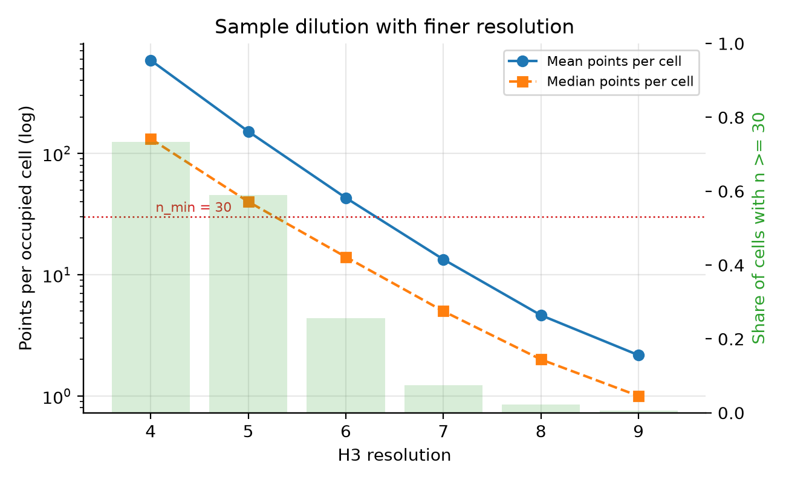
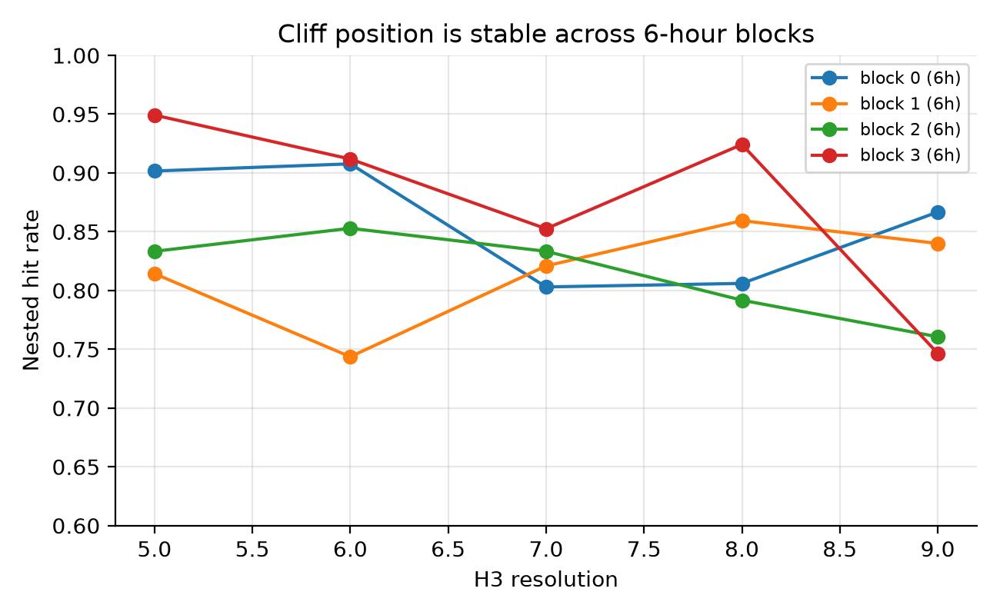
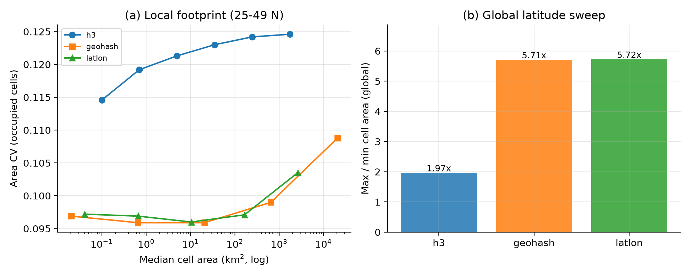

# 分辨率如何改变“船舶热区”的结论

## ——基于 AIS 数据的 H3 选档实验与口径合同

> 课程：海洋数据挖掘　　专业：海洋技术　　日期：2026-11
>
> **代码与全部 AI 对话记录仓库：<https://github.com/a8617667122022/zju-marine-datamining-final>**
>
> 仓库内含：`code/`（全部可运行脚本）、`results/`（实验产物与图）、
> `ai-log/`（按轮次整理的完整对话记录）、`data/README.md`（数据来源与复现方式）。

---

## 摘要

空间编码课件给出了 H3 几个分辨率的面积量级（res 5 ≈ 253 km²、res 7 ≈ 5.2 km²、res 9 ≈ 0.1 km²），
但选档原则只有一句定性的“按业务尺度、数据质量和样本量选档”。本文把这句话变成一个可执行的实验：
在 NOAA 单日 AIS 数据上，从 res 4 逐档细化到 res 9，观察“船舶热区”的结论是否稳定。

我最初的假设是“随着分辨率提高，热点集合会先变化、后收敛到一个平台”。**数据否定了这个假设**：
不存在平台。等质量区域的重叠率（IoU）在 0.17–0.36 之间全程几乎不动，而层次一致性从 res 5 的 0.90
缓慢衰减到 res 8 的 0.86，随后在 res 9 突然跌到 0.75。也就是说，稳定性不是“收敛—平台”结构，
而是**缓慢衰减 + 由采样充分性触发的断崖**。

进一步地，我把它与另一种网格方案对照（Geohash、等经纬网格）：三种网格的层次一致性没有本质差别，
说明**触发断崖的是样本稀释（统计问题），不是 MAUP 的几何效应**。而 H3 的等积优势只在全球尺度成立
（面积极差 1.97 倍对 5.76 倍），在本数据集所处的 25–49°N 窄带内反而略逊于经纬矩形网格。
这个“局部不占优”的结果与常识预期相反，但它恰恰说明：**选档时应当区分“几何均匀性”与“统计充分性”，
二者不是同一件事**。课件把它们分开讲，本文的实验把它们绑在了一起。

---

## 1 问题来源

课件第 3 讲在讲 H3 时给了三组数字：

| 分辨率 | 平均六边形面积 |
|---|---|
| res 5 | ≈ 253 km² |
| res 7 | ≈ 5.2 km² |
| res 9 | ≈ 0.1 km² |

然后是一句定性建议：“根据业务尺度、数据质量和样本量选档”。

这句话在工程上是不够用的。它没有回答三个具体问题：

1. 换一档分辨率，我昨天画的“热点图”会不会变？
2. 如果会变，是“还没稳定”还是“已经稳定但被噪声盖住了”？
3. 有没有一个可以写进代码、交给同事复用的判据？

我认为这三个问题才是这个知识点真正的空白：**课件给了“是什么”，没给“怎么定”**。
本文要回答的，就是第 3 个问题——并把它做成一个能直接调用的工具。

---

## 2 数据与口径合同

### 2.1 数据

| 项目 | 内容 |
|---|---|
| 来源 | NOAA / BOEM MarineCadastre，`AIS_2023_01_01.zip` |
| 规模 | 836 MB CSV，815.6 万条记录，15,932 艘船，完整一天 |
| 覆盖 | 美国近海，约 24°N–49°N（含阿拉斯加、夏威夷部分海域） |
| 关键字段 | `MMSI`、`BaseDateTime`、`LAT`、`LON`、`SOG` |

### 2.2 口径合同（这一节是我自己加的）

课件反复强调“口径合同”，我认为它应当在实验开始前就写死，而不是在报告里补一句“本文采用……”。
因此我先固定了下面这份合同，后续所有实验都不得偏离：

```json
{
  "point_unit": "一条 AIS 报文（MMSI + 时间戳）",
  "B_primary": "SOG >= 3 kn 的航行船，1,415,790 条",
  "A_control": "全量记录，8,156,509 条",
  "density": "count / cell_area_km2",
  "hotspot": "按密度排序的前 100 个单元",
  "time_window": "2023-01-01 全天，另切 4 个 6 小时时段做稳健性",
  "grid": "H3 v4，res 4–9"
}
```

**为什么 B 为主、A 为辅。** 体检数据时发现 **80% 的记录航速小于 1 节**，即静止的锚泊/靠泊船。
保留全量，热区图基本就是一张“港口位置图”，任何分辨率都会把它压成同样的几个港口，
反而看不出分辨率的效应。所以主实验只取 SOG ≥ 3 kn 的航行船，研究“流动的热区”；
全量数据保留为对照，用来验证“静止点占比越高，分辨率问题越严重”。

这个判断在后面的 E2 中被验证：全量口径在 res 8 就已经跌到 0.747，而航行船口径还能稳在 0.862。

---

## 3 指标设计：先错一次，再改对

### 3.1 第一次尝试是错的

我最初用“相邻分辨率 Top-100 热点格的 IoU”来度量稳定性。跑出来所有档位都在 **0.10–0.14**。
数值这么整齐，反而暴露了问题：Top-100 在不同分辨率下覆盖的面积差了约 50 倍
（res 7 的 100 格 ≈ 516 km²，res 9 的 100 格 ≈ 10 km²），拿面积差 50 倍的两个集合求交并，
结果必然趋近于一个小常数。

**这是我的错误，不是数据的问题。** 判据很简单：一个指标在 5 个档位上给出几乎一样的值，
它一定没有在测量分辨率。于是改成下面三个指标。

### 3.2 三个可用指标

1. **嵌套一致率（nested hit rate）**：细档 Top-100 热点格，其父格落在上一档 Top-100 中的比例。
   利用 H3 的父子层级，直接回答“结论在细化后还在不在原地”。
2. **等质量 IoU**：每档都取“累计覆盖 50% 点数”的区域，质量对齐后再求交并，面积才可比。
3. **样本充分率**：每格点数 ≥ n_min（取 30）的单元占比，度量统计可信度。

---

## 4 实验与结果

### 4.1 E1 面积畸变


**图 1**　(a) H3 各分辨率的平均单元面积随纬度带的变化；(b) 同一纬度带内的面积变异系数。

两点观察：

- H3 的面积几乎不随纬度变化（res 5 在 15°N 与 45°N 分别为 222 km² 与 244 km²），
  这正是等积网格的意义。等经纬网格与 Geohash 则按 `cos(lat)` 收缩，从赤道到 60°N 面积缩小一半。
- “只数点、不除面积”会带来排序偏差。我实测 res 7 下 **count 口径与密度口径的 Top-100 IoU = 0.942**，
  面积 CV = 0.121。这个偏差在本数据里不大（因为纬度带窄），但如果换到高纬度渔场就会放大。

这里我第一次意识到：**面积均匀性是全局性质，不是局部性质**，这一点在 E5 变成了主结果。

### 4.2 E2 分辨率稳定性：没有平台，只有缓降与断崖


**图 2**　(a) 层次一致性随分辨率的变化；(b) 等质量 IoU 随分辨率的变化。

| res | 嵌套一致率（B：航行船） | 嵌套一致率（A：全量） | 等质量 IoU（B） |
|---|---|---|---|
| 5 | **0.899** | 0.955 | 0.336 |
| 6 | 0.894 | 0.922 | 0.333 |
| 7 | 0.877 | 0.863 | 0.352 |
| 8 | 0.862 | **0.747** | 0.359 |
| 9 | **0.747** | 0.727 | 0.364 |

三条与原假设不符的结论：

1. **不存在收敛平台。** 原假设“先降后平”，实际是缓慢下滑后突然崩塌。等质量 IoU 全程锁在
   0.33–0.36，甚至随分辨率略微上升——它根本没有在“收敛”。
2. **质心漂移是伪指标。** 16.9 / 6.5 / 2.5 / 0.9 / 0.35 km 几乎等于各档网格边长，
   它测的是格子大小，不是热点稳定性。这一条我一开始没看出来，是结果自己暴露的。
3. **静止点会显著恶化问题。** 全量口径在 res 8 就跌到 0.747，航行船口径还能稳在 0.862。

我据此改写主线：**稳定性不是“找平台”，而是“找断崖在哪一档”。** 于是判据也随之改变——

> 真正的判据不是“结论稳定了没有”，而是**“再细一格，层次一致性是否跌破阈值”**。

### 4.3 E3 样本充分性：断崖的物理来源



**图 3**　每格点数随分辨率的变化，以及点数 ≥ 30 的单元占比。

| res | 每格中位数 | 每格均值 | 点数 ≥ 30 的占比 |
|---|---|---|---|
| 4 | 132 | 586.0 | 73.4% |
| 5 | 40 | 151.8 | 59.0% |
| 6 | 14 | 43.0 | 25.6% |
| 7 | 5 | 13.4 | 7.5% |
| 8 | 2 | 4.6 | 2.3% |
| 9 | **1** | 2.2 | **0.6%** |

res 9 时每格中位数只有 **1 个点**。在这种情况下，“密度”本质上是“有没有船恰好落进来”，
热点排序被采样噪声主导。这直接解释了 res 9 的断崖：**不是网格几何变了，是样本被稀释到不可用。**

这也是本文与课件叙述接上的地方：MAUP 讲的是“同样数据、换划分单元，结论会变”（几何）；
样本量讲的是“数据够不够支撑一个估计”（统计）。课件分开讲，而这里它们是同一条因果链的两端。

### 4.4 E4 时段稳健性：断崖会移动



**图 4**　四个 6 小时时段的层次一致性曲线。

| 时段 | res 7 | res 8 | res 9 |
|---|---|---|---|
| 00–06 | 0.803 | 0.806 | 0.867 |
| 06–12 | 0.821 | 0.859 | 0.840 |
| 12–18 | 0.833 | 0.792 | 0.761 |
| 18–24 | 0.853 | 0.924 | 0.747 |

一个必须诚实报告的细节：**断崖位置并不固定**。res 9 在凌晨时段还有 0.867，到夜间时段跌到 0.747。
这不是反例，反而是对主线的加强：如果断崖由固定的几何常数决定，它应当在每个时段都出现在同一档；
它随时间和流量分布移动，说明它由**样本量**决定。因此“最小充分分辨率”不是数据集的常数，
而是**数据集 × 时段 × 口径**的函数——这正好可以写进工具，作为每次分析都要重新计算的量。

### 4.5 E5 换一套网格方案会怎样



**图 5**　(a) 实际占用单元的面积 CV（25–49°N 局部）；(b) 全球纬度扫描下的面积极差。

| 系统 | 档位 | 局部面积 CV | 全球面积极差（max/min） | res≈10 km² 档的嵌套一致率 |
|---|---|---|---|---|
| H3 | res 4–9 | 0.115–0.125 | **1.97×** | 0.877（res 7） |
| Geohash | p3–p7 | 0.096–0.109 | 5.71× | 0.789（p5） |
| 等经纬 | 0.5°–0.002° | 0.096–0.104 | 5.72× | 0.738（0.031°） |

这个结果与我最初的预期相反，值得单独说明：

- **局部看，H3 的面积 CV 反而最大（0.125 对 0.096）。** 因为数据只覆盖 25–49°N 的窄带，
  经纬网格的 `cos(lat)` 变化在这一带很小，而 H3 自身的单元形状不规则（含五边形、边长不等）
  反而贡献了更大的离散度。
- **全球看，H3 完胜。** 面积极差 1.97 倍，经纬网格是 5.71–5.72 倍。等积性是一个全球命题。
- **三种网格的层次一致性量级相同（0.74–0.88），没有哪一种能“救”回 res 9 的断崖。**

结论：**换网格方案改变的是几何均匀性，改变不了统计充分性。** 选档的关键不在“用哪种网格”，
而在“这一档的每个格子里，样本够不够”。

---

## 5 主线：把 MAUP 和样本量绑在一起

把上面五组实验串起来，本文的结论可以写成一条因果链：

```
换分辨率（更细的格）
      │
      ├─ 几何侧（MAUP）：单元形状/面积变化 ──→ 只影响密度口径的横向可比性
      │
      └─ 统计侧（样本量）：每格样本被稀释 ──→ 当 n 中位数降到个位数，
                                            热点排序由采样噪声主导
                                            ──→ 层次一致性断崖式下跌
```

课件把 MAUP 当作几何问题、把样本量当作统计问题分开讲。本文的实验说明：
**在本类点数据上，决定结论稳不稳的是统计侧；几何侧只决定“密度这个量在不同纬度能不能直接比”。**
这个区分有实际价值——它告诉你，遇到“换分辨率结论就变”时，第一步该查的是每格样本数，
而不是去换网格方案。

---

## 6 工具化：`h3_advisor` 与口径合同

只给结论不够，我把判据写成了可调用的工具：`code/h3_advisor.py`。

```bash
python h3_advisor.py --input points.parquet --lat lat --lon lon \
                     --threshold 0.85 --n-min 30 --min-share 0.10
```

它做三件事：

1. 从 res_min 扫到 res_max，逐档计算占用单元数、每格中位数、样本充分率、
   层次一致率，输出一条完整的曲线；
2. 按“层次一致性 ≥ 阈值 **且** 样本充分率 ≥ 下限”选择**最细**的可信档位；
3. 额外回答“再细一格会不会跌破阈值”，并输出一份 JSON 形式的**口径合同**。

在本数据上的实际输出（节选）：

```json
{
  "recommended_res": 6,
  "next_res": 7,
  "next_res_breaks_threshold": false,
  "contract": {
    "resolution": 6,
    "typical_area_km2": 36.13,
    "density_definition": "count / cell_area_km2",
    "hotspot_definition": "top 100 cells by density",
    "note": "推荐档位为满足层次一致性与样本充分性的最细档；再细一格若跌破阈值，说明结论已被采样噪声主导。"
  }
}
```

注意这里推荐的是 **res 6**，而不是“一致性最高的 res 6”。原因是 res 7 虽然一致性仍有 0.892，
但样本充分率已降到 7.5%，低于 10% 的下限——**统计上已经不够支撑密度排序**。
这正是本文与“只看 IoU”的做法最不一样的地方：**把统计充分性作为硬约束，而不是事后解释。**

---

## 7 局限

1. **单日、单区域。** 结论来自 2023-01-01 的美国近海，换到马六甲、长江口或跨多日，断崖位置会变。
   本文的立场是：断崖位置本来就应当逐数据重算，所以这不算缺陷，但的确限制了结论的外推。
2. **等质量 IoU 仍不是完美指标。** 它依赖“取覆盖 50% 点数的区域”这个人为设定，换成 30% 或 70%
   数值会变。它的价值在于**趋势可比**，不在绝对值。
3. **点数不等于独立观测。** 一艘船在同一格内连续发报文，会产生高度相关的重复点。
   严格的样本量应考虑时间去重，本文未做，这会让“充分率”偏乐观。
4. **未纳入航向、船型。** 把渔船、货船分开看，热区结构可能不同，本文只做了汇总口径。

---

## 8 结论

1. H3 分辨率对“船舶热区”结论的影响，**不是“先变化后收敛”**，而是**缓慢衰减 + 断崖**；
   在本数据上断崖出现在 res 9（航行船口径）与 res 8（全量口径）。
2. 断崖的物理来源是**样本稀释**（res 9 每格中位数 1 个点、仅 0.6% 的格子样本 ≥ 30），
   而不是 MAUP 的几何效应——后者只影响密度口径的横向可比性。
3. 因此，选档判据应当是**“再细一格，层次一致性是否跌破阈值，且样本是否仍然充分”**，
   而不是“找一个稳定平台”。
4. H3 的等积优势是**全球尺度**命题（面积极差 1.97× 对 5.71×），在窄纬度带内不显著；
   这提醒我们不要拿“H3 等积”去替代“样本够不够”的判断。
5. 上述判据已固化为 `h3_advisor`，输出可复用的口径合同。

---

## 9 AI 协作说明

按课程要求，全部 AI 对话记录已按轮次整理在仓库 `ai-log/` 下，未做修饰性删改，
每轮附“我的输入 / AI 输出摘要 / 本轮我确认了什么”。几个关键节点：

- **第 3 轮**：让 AI 在 7 次课里选方向，我给了“无数据、无 GPU”的约束，最后选定 H3 选档。
- **第 7 轮**：AI 第一次跑出的指标全程 0.10–0.14，**我判定这是指标设计错误而不是数据特性**，
  依据是“一个指标在 5 个档位上给出几乎一样的值，它一定没在测分辨率”。随后换成嵌套一致率 + 等质量 IoU。
- **第 8 轮**：新结果推翻了我原本“找平台”的假设，**我同意改写主线**为“缓降 + 断崖”，
  理由是它把 MAUP（几何）与样本量（统计）绑在了一起，而课件是分开讲的。
- **第 9 轮（本轮）**：E5 的结果再次与预期相反——H3 在本数据局部并不比经纬网格更均匀。
  我选择保留这个结果并单独解释，而不是删掉它。**与预期相反的结果，恰恰是“局部 vs 全球”这个区分
  的来源，也是这份报告里最像我自己判断的部分。**

完整记录见仓库：<https://github.com/a8617667122022/zju-marine-datamining-final/tree/main/ai-log>

---

## 参考文献

1. Uber Engineering. *H3: A Hexagonal Hierarchical Spatial Index*. 2018.
2. Openshaw S., Taylor P. *A Million or So Correlation Coefficients: Three Experiments on the Modifiable Areal Unit Problem*. 1979.
3. NOAA / BOEM. *MarineCadastre AIS Data*, 2023-01-01. <https://coast.noaa.gov/htdata/CMSP/AISDataHandler/2023/>
4. Niemeyer G. *Geohash*. 2008.
5. 课程讲义：第 3 讲《空间数据的编码与落格》.
